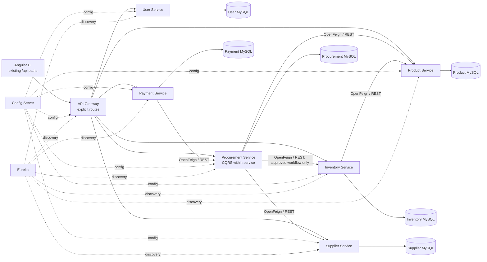
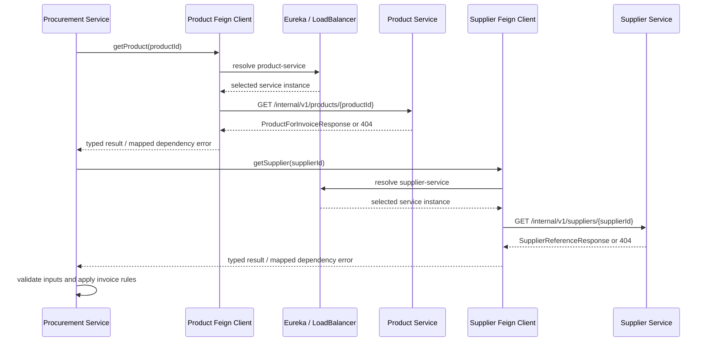

# Team Development Guide

**Purpose:** Shared, evidence-based guide for developing and integrating the
six business services while the purchasing and stock-management monolith stays
operational.

**Repository evidence reviewed:** 2026-11-13. This guide distinguishes
approved architecture rules, implementation visible in the repository, and
decisions/contracts that are still pending. It does not claim that a design
document makes a feature operational.

## Table of contents

1. [Project scope and current state](#1-project-scope-and-current-state)
2. [Target architecture and ownership](#2-target-architecture-and-ownership)
3. [Synchronous service communication](#3-synchronous-service-communication)
4. [Service implementation structure](#4-service-implementation-structure)
5. [Configuration, discovery, and Gateway](#5-configuration-discovery-and-gateway)
6. [Database ownership and Flyway](#6-database-ownership-and-flyway)
7. [REST API standards](#7-rest-api-standards)
8. [Security and secrets](#8-security-and-secrets)
9. [Testing and integration](#9-testing-and-integration)
10. [Git workflow and parallel development](#10-git-workflow-and-parallel-development)
11. [Definition of Done](#11-definition-of-done)
12. [Implementation roadmap](#12-implementation-roadmap)
13. [Architectural decision register](#13-architectural-decision-register)
14. [Contradictions, open decisions, and evidence limits](#14-contradictions-open-decisions-and-evidence-limits)
15. [Repository references](#15-repository-references)

## 1. Project scope and current state

This is a purchasing and stock-management application, not customer
e-commerce. The monolith manages products/categories, stock, suppliers/sectors,
operators, supplier invoices and invoice details, and supplier-invoice
settlements. It remains operational during migration. Do not reinterpret
supplier invoices as customer orders.

| Area | Current repository evidence |
|---|---|
| Monolith | `backend/`, Spring Boot 4.1.1, Java 21, Maven; default port 8089. Do not upgrade or change it as part of service extraction. |
| Frontend | `frontend/`, Angular 21; development server defaults to port 4200 and uses relative `/api` URLs. |
| Infrastructure | Independent Maven reactor in `infrastructure/`: Config Server, Eureka Discovery Server, and API Gateway. Java 21, Spring Boot 4.0.9, Spring Cloud 2025.1.4. |
| Gateway | Port 8080; currently only the monolith fallback route `/api/**` → monolith port 8089, applying `StripPrefix=1`. Automatic discovery routes are disabled. |
| Angular development proxy | `frontend/proxy.conf.json` forwards `/api` unchanged to `http://localhost:8080`; it does not strip `/api`. |
| Product Service | A standalone project exists at `product-service/`, defaults to port 8082, and has CRUD API code, Flyway DDL, Config Client, and Eureka Client. Its Gateway cutover is intentionally deferred. |
| Other business services | No service implementations are present in the repository for Inventory, Supplier, User, Procurement, or Payment. |
| Source database | The monolith uses MySQL and Hibernate `ddl-auto=update`; deployed DDL/data have not been verified. Entity-based table names below are inferences, not confirmed physical schema. |

The initial connection path for local frontend development is:

```text
Angular :4200
  -> /api/** proxy unchanged
API Gateway :8080
  -> StripPrefix=1
Monolith :8089
```

The Product Service currently does **not** receive Gateway traffic. In
particular, the Gateway still forwards Product paths to the monolith. This
avoids breaking the existing stock-assignment endpoint and product response
compatibility while Inventory's contract is unresolved.

The baseline recorded 46 monolith REST endpoints and 38 backend tests, with
one Testcontainers context-start error caused by Docker availability at that
time. Consult [the baseline](docs/migration/03-baseline-validation.md) and
[the endpoint inventory](docs/migration/04-existing-api-contracts.md) for
details. That result is a recorded baseline, not a claim about a new test run.

## 2. Target architecture and ownership

There are exactly six business services. Config Server, Eureka, and Gateway
are infrastructure applications and are not part of that count. Each
business service owns its schema and writes. Cross-service identifiers are
scalar values; do not share JPA entities, repositories, SQL access, database
credentials, or foreign keys across service boundaries.



Solid service-to-service relationships in this guide are synchronous REST.
Dashed infrastructure links are configuration/discovery, not business calls.
The diagram does not authorize an API path or a production route by itself.

### Service ownership matrix

“Likely legacy table” means inferred from entity naming and the current JPA
model. It does not verify deployed MySQL names or constraints. Product target
table names are defined in the new service's Flyway migration, but the
Testcontainers/MySQL integration test has not completed in this environment.

| Service | Responsibilities and owned data | Legacy entities / likely legacy tables | Public API responsibility | External IDs and dependencies | Explicit exclusions |
|---|---|---|---|---|---|
| **Product** (`product-service`) | Product catalog, categories, validation, current catalog price. | `Produit` / likely `produit`; `CategorieProduit` / likely `categorie_produit`. New target migration declares `products` and `product_categories`. | Preserve legacy `/produits/**` and `/categories-produits/**` contracts during a separately approved cutover. Current service implements Product and Category CRUD only. | Product IDs are consumed by Inventory and Procurement. Procurement needs an agreed catalog/price snapshot contract. | Stock quantities, stock/location assignment, reservations, movements, suppliers, invoices, settlements. No JPA link to Inventory. |
| **Inventory** (`inventory-service`) | Stock positions/quantities, movements, and approved reservations/alerts. | `Stock` / likely `stock`; target position and movement tables are new and need design. The old model has one stock quantity and product-to-stock association; it does not prove a per-product position model. | Preserve `/stocks/**`; define product assignment, availability, movement, and receipt APIs with Product/Procurement owners. | Uses Product IDs as values; receives Product existence/details via REST as required. Procurement may issue an idempotent receipt/adjustment command only for an approved goods-receiving workflow. | Product metadata/pricing, supplier master, invoices, user credentials, settlements. |
| **Supplier** (`supplier-service`) | Supplier master and activity sectors, supplier details, sector membership. | `Fournisseur` / likely `fournisseur`; `DetailFournisseur` / likely `detail_fournisseur`; `SecteurActivite` / likely `secteur_activite`; supplier-sector join table name unknown. | Preserve `/fournisseurs/**` and `/secteurs-activite/**`; define supplier lookup for Procurement. | Procurement references Supplier IDs and validates supplier data through REST. | Invoices, invoice lines, operators, stock, settlements. |
| **User** (`user-service`) | Operator identities and approved authentication, roles, permissions, and account lifecycle. | `Operateur` / likely `operateur`. Auth/role tables do not exist in verified source evidence and need design. | Preserve `/operateurs/**` as an approved compatibility API; own identity/token-related APIs once security is approved. | Other services hold operator/approver IDs. Services validate JWTs locally when possible; avoid a User Service call for every request. | Invoice ownership/workflow, business records, product/inventory/supplier data, settlement history. Existing password storage is not evidence of secure hashing. |
| **Procurement** (`procurement-service`) | Supplier invoices, invoice lines, purchasing workflow/approval lifecycle, and CQRS read/write models per approved design. | `Facture` / likely `facture`; `DetailFacture` / likely `detail_facture`; workflow/CQRS data is new. | Preserve `/facture/**`; invoice details currently have no standalone REST controller. Define internal APIs with consumers. | Product ID and immutable line snapshots; Supplier ID; operator/approver ID; Inventory only for an approved receipt workflow. Payment integration must avoid reciprocal call loops. | Supplier master, Product catalog, physical stock, credentials, settlement records. This is not a customer order service. |
| **Payment** (`payment-service`) | Supplier-invoice settlements, payment history, reconciliation and payment-side audit. | `Reglement` / likely `reglement`; any invoice reference projection is new and requires approval. | Preserve `/reglements/**` and reporting routes as approved; define invoice eligibility lookup/command contracts. | References Procurement invoice IDs and uses REST to validate invoice/payment eligibility under an agreed workflow. | Procurement-owned invoices and workflow, Supplier master, product and stock data. |

Existing mappings and migration implications are summarized in
[05-database-migration-inventory.md](docs/migration/05-database-migration-inventory.md).
The authoritative target boundaries and older-versus-revised proposal history
are in
[02-revised-target-architecture.md](docs/migration/02-revised-target-architecture.md).

## 3. Synchronous service communication

### Required project rule

For inter-microservice communication, use synchronous HTTP REST. **Spring
Cloud OpenFeign (`@FeignClient`) is the default client. `RestTemplate` is
permitted only where justified or required by a specific academic constraint.**
Resolve service IDs through Eureka and Spring Cloud LoadBalancer. Do not
hardcode a host, IP, or service port in service client code.

Do not add RabbitMQ, Kafka, or another cross-service asynchronous messaging
system. The earlier architecture documents contain event-transport proposals;
the professor's synchronous REST requirement takes precedence for this
project's cross-service communication. Procurement's CQRS/Axon requirement
remains an in-service architecture concern; do not treat Axon or an event bus
as an approved cross-service transport.

```java
@FeignClient(name = "product-service")
public interface ProductClient {
    @GetMapping("/internal/v1/products/{productId}")
    ProductReferenceResponse getProduct(
            @PathVariable Long productId);
}
```

The example path is **proposed**, not an existing Product Service endpoint.
Use `@FeignClient(name = "registered-service-id")`, DTOs owned by the caller's
contract, and properties externalized through Config Server. Add
`spring-cloud-starter-openfeign` and enable Feign scanning only in a service
that actually calls another service. The current Product Service makes no
outbound call and has no Feign dependency/client.

### Communication relationship register

All inter-service API paths below are proposed contract shapes unless
explicitly called out as existing. Owners must agree them before coding.
Internal APIs should not be exposed through the public Gateway by default.

| Caller → target | Business reason | Proposed request / response DTO | Error and availability behavior | Status |
|---|---|---|---|---|
| Inventory → Product | Check product identifier and retrieve catalog information needed for an inventory operation. | `GET /internal/v1/products/{productId}`; request path ID. Proposed `ProductReferenceResponse { productId, code, label }`; add lifecycle state only after Product ownership decides it. | `200` known ID; `404` unknown ID; `503`/timeout if Product is unavailable. Inventory must not silently treat an unavailable Product as valid or absent. | Required dependency in target; exact endpoint and fields pending. |
| Procurement → Product | Validate invoice-line references and obtain the catalog snapshot needed at invoice creation. | `GET /internal/v1/products/{productId}` or a later batch equivalent; proposed `ProductForInvoiceResponse { productId, code, label, price, currency }`. Currency and price version are currently undefined. | `404` invalid Product; `503`/timeout is a visible dependency failure, not a fabricated success. Do not recalculate existing invoice-line snapshots from current price. | Required dependency; contract and monetary fields pending. |
| Procurement → Supplier | Validate supplier and retrieve master data required for supplier invoices. | `GET /internal/v1/suppliers/{supplierId}`; proposed `SupplierReferenceResponse { supplierId, code, label, active }`. `active` requires lifecycle approval. | `404` unknown Supplier; `503`/timeout prevents actions requiring fresh validation. No database lookup across services. | Required dependency; exact route/fields pending. |
| Procurement → Inventory | Record received goods or other explicitly approved stock operation. Invoice creation/approval alone must not change physical stock. | Proposed idempotent `POST /internal/v1/receipts` with `ReceiptRequest { idempotencyKey, invoiceId, lines: [{ productId, quantity }] }`; response `ReceiptResponse { receiptId, status }`. Quantity units and workflow trigger must be agreed. | Validate Product IDs; return a conflict for a duplicate key with the documented prior result; distinguish invalid references from timeout/unavailable Inventory. Do not retry non-idempotent commands without idempotency. | Conditional; only if a goods-receiving workflow is approved. |
| Payment → Procurement | Retrieve invoice state and determine whether a settlement is eligible. | Proposed `GET /internal/v1/invoices/{invoiceId}/payment-eligibility`; response `InvoicePaymentEligibilityResponse { invoiceId, eligible, outstandingAmount, currency, reasonCode }`. Amount/currency/status contract pending. | `404` unknown invoice; `409` known but ineligible; `503`/timeout means do not accept settlement based on stale/guessed state. | Required relationship in the requested target; contract pending. |
| User → other services / Gateway | Issue/manage authentication-related information; consumers verify claims and authorize business operations. | JWT/JWKS or another issuer/key contract has not been selected. Do not invent token DTOs or trust caller-supplied identity headers. | Reject invalid/expired tokens according to the approved security model. User Service outage should not require a live per-request User call if token verification can be local. | Responsibility approved; security implementation pending. |

The target architecture also sketches Procurement → Payment settlement
commands/queries. This can create a reciprocal dependency with Payment →
Procurement. Do not add both call directions by default. Procurement, Payment,
and business owners must agree the authoritative command path, eligibility
consistency, timeout behavior, and cycle-free workflow before implementing
that additional relationship.

### Feign, timeout, and failure standards

- Use service IDs (`product-service`, `supplier-service`, etc.) with Eureka
  and LoadBalancer. No URL per environment in Java annotations.
- Keep clients in a service's `client/` or `infrastructure/client/` package.
  Use explicit, caller-owned request/response DTOs; never import a remote JPA
  entity or reuse persistence objects as wire contracts.
- Configure bounded connect/read timeouts centrally through externalized
  properties. Choose values based on the operation and deployment environment;
  no project-wide numeric timeout has been approved yet.
- Map remote `404`, validation failures, conflicts, timeouts, and
  `5xx`/service-unavailable errors explicitly at the application boundary.
  Preserve the meaning of downstream errors without leaking internal stack
  traces or secrets.
- No retries by default. Retries must be bounded and limited to transient,
  safe/idempotent operations. Mutating requests require an idempotency key or
  an operation-specific proof that retrying is safe.
- Circuit breakers/bulkheads (for example, Resilience4j) are **proposed**, not
  currently implemented or approved as a project-wide dependency. If adopted,
  they must expose failure rather than return success-shaped fallback data.
- Avoid long synchronous chains and reciprocal calls. Consider request
  fan-out limits and total caller deadline; don't hold database transactions
  open while making remote requests.
- Test successful responses, `404`, invalid requests/responses, `409`,
  downstream `5xx`, connection failure, and timeout. Mock Feign for caller
  unit tests; use a service integration environment for provider/consumer
  compatibility tests.



This illustrates proposed contract calls, not currently implemented Feign
clients or endpoints.

## 4. Service implementation structure

Each business service is a standalone Maven project with its own wrapper,
build, runtime configuration, tests, and database migrations. Do not add a
business service to `infrastructure/pom.xml`. Keep dependency directions
inside one service clear and avoid layers that only forward a call.

```text
<service-name>/
  pom.xml
  mvnw
  mvnw.cmd
  .mvn/wrapper/
  README.md
  src/
    main/
      java/<organization>/<domain>/
        api/                 # HTTP controllers and API configuration
        api/dto/             # Request/response types (or api/dto/)
        application/         # Use cases, orchestration, transaction boundary
        domain/              # Business entities/rules and domain errors
        infrastructure/
          persistence/       # JPA repositories and persistence adapters
          client/            # Feign clients and remote adapters, when needed
        config/              # Only service-specific framework configuration
      resources/
        application.properties
        db/migration/
    test/
      java/
      resources/
```

Use only packages the service needs. The Product Service currently uses
`api`, `api.dto`, `application`, `domain`, and `infrastructure.persistence`.
The shared standards also describe hexagonal `ports/adapters`; either naming
style is acceptable when the service retains clear boundaries.

| Component | Convention |
|---|---|
| Controller | HTTP mapping, DTO validation, status/headers, delegation. No business rules or repository calls. |
| Application service | Use-case orchestration and service-owned transaction boundaries. Keep remote calls outside long-running database transactions where possible. |
| Domain/entity | Owned business state only. No cross-service entity association; IDs from other services are scalar values. |
| Repository | Persistence for this service's tables only. |
| DTO | Explicit API contract; separate from persistence entities. Preserve legacy field names where compatibility requires them. |
| Mapper | Use a mapper when transformations are non-trivial or reused; do not add a mapping framework solely by convention. |
| Feign client | Declarative synchronous REST adapter, resolved by service ID, with typed DTOs and tested error mapping. |
| Exception handling | Central service advice; stable HTTP statuses and documented safe error representation. Never return fabricated success on failures. |
| Configuration | Config Data and environment-specific external properties. Do not commit credentials. |
| Validation | Validate request shape at the API boundary and enforce business invariants in the domain/application layer as appropriate. |

### Maven and version conventions

- Java 21. New Cloud applications use Spring Boot 4.0.9 and import Spring
  Cloud BOM 2025.1.4.
- The monolith stays on Spring Boot 4.1.1 and is not included in the new
  services' reactor.
- Use Maven Wrapper 3.10.0 as in `infrastructure/`, unless the platform owner
  approves a common change.
- Let the Spring Cloud BOM manage Cloud starter versions. Do not hardcode
  individual Cloud dependency versions.
- Add OpenFeign only to a service that actually makes synchronous REST calls.
  No RabbitMQ or Kafka dependency is allowed for cross-service messaging.
- Keep `infrastructure/pom.xml` infrastructure-only.
- Verify the independent build with `.\mvnw.cmd clean verify`; do not skip
  tests in merge validation.

## 5. Configuration, discovery, and Gateway

### Config Server and Eureka

Current local infrastructure defaults:

| Application | Default port | Repository implementation |
|---|---:|---|
| Config Server | 8888 | Config Server project and Git-backed `config-repo/`. It bootstraps locally rather than importing its own configuration. |
| Eureka Discovery Server | 8761 | Eureka Server; configured not to register itself or fetch its own registry. |
| API Gateway | 8080 | WebFlux Gateway, Eureka Client and LoadBalancer; discovery route locator disabled. |
| Monolith | 8089 | Existing backend and fallback destination. |
| Product Service | 8082 | Standalone service default; currently includes Config Client and Eureka Client. |

For each business service:

1. Choose a unique lowercase `spring.application.name` and use the exact
   registered service ID for clients and Gateway destinations.
2. Load centralized settings using Spring Boot Config Data, for example
   `spring.config.import=configserver:${CONFIG_SERVER_URL:http://localhost:8888}`.
3. Register with Eureka using environment-specific service URL/advertised
   address settings. A host's `localhost` is not generally reachable from a
   container.
4. Externalize application port, JDBC URL, database username/password, and
   other environment-specific values. Config Git may contain placeholders and
   safe defaults, never real credentials.
5. Expose only necessary health/info endpoints. Do not expose configuration
   contents or sensitive health details.
6. Start Config Server before Eureka, then Gateway and business clients.
   Startup order is not readiness; the application must fail clearly if
   required configuration or database initialization is unavailable.

The current Product Config Server document has a local `product_service`
database URL default and requires credentials through
`PRODUCT_DB_USERNAME` / `PRODUCT_DB_PASSWORD`. Provide real secrets outside
Git. Do not start Product Service against an unapproved or shared database.

### Gateway and frontend compatibility

The current Gateway route in `config-repo/api-gateway.yml` is only:

```text
Path=/api/**
  -> MONOLITH_BASE_URL (default http://localhost:8089)
  -> StripPrefix=1
```

Add reviewed explicit routes for extracted services before the fallback, with
service discovery (for example `lb://product-service`) and exactly one
`StripPrefix=1`. Keep automatic discovery routing disabled. Preserve methods,
queries, bodies, status codes, headers, and existing Angular paths. Unextracted
domains continue to use the monolith fallback.

The current frontend proxy does not strip `/api`; the Gateway does it once.
Do not add another rewrite in Angular or Gateway. Test both a collection path
such as `/api/produits` and nested paths. Product and Category routes must not
be added until Product data/cutover acceptance and the Inventory stock
assignment/`stockId` compatibility contract are resolved. See the [Gateway
configuration](config-repo/api-gateway.yml) and [frontend proxy](frontend/proxy.conf.json).

## 6. Database ownership and Flyway

### Ownership

- Each service has a separately owned MySQL database/schema and separate
  credentials with least privilege.
- A service can read/write its own database only. No shared cross-service
  writes, SQL queries, database credentials, cross-service JPA mappings, or
  foreign keys.
- Represent external references as stable IDs. Store a purpose-limited
  snapshot only when the owning consumer needs it; record the source and
  freshness semantics.
- The old application uses JPA relationships across the future boundaries,
  including Product–Stock, Invoice–Supplier/Product, Operator–Invoice, and
  Settlement–Invoice. Replace these with service-owned references/contracts
  during extraction; do not copy the cross-service ORM graph.
- The source schema has not been inspected. Inferred legacy names in the
  ownership table are not migration DDL. Inspect verified DDL, constraints,
  indexes, data, duplicates, and IDs before designing a backfill.
- Product Service currently defines new target tables named `products` and
  `product_categories` in its Flyway migration. These do not assert that the
  source tables have those names. Other target database/table details remain
  service design work.

### Flyway conventions

Use Flyway for each service, with files under
`src/main/resources/db/migration/`:

```text
V1__create_categories_table.sql
V2__create_products_table.sql
V3__add_product_price.sql
```

- Use monotonically increasing version numbers and descriptive,
  underscore-separated names. One logical, reviewable schema change per
  migration.
- Flyway applies pending migrations at service startup unless a deployment
  process explicitly runs them separately. Verify environment-specific
  policy; never point a service at another service's database.
- Never edit a migration that has already been applied in a shared
  environment. Add a new versioned migration.
- Test on a clean disposable MySQL database and upgrade from the prior
  supported schema. Do not assume H2 is MySQL-equivalent.
- Verify Flyway history, table/column definitions, constraints, indexes, and
  representative reads/writes. Record migration evidence.
- On failure, stop deployment, inspect the Flyway error and schema state, and
  follow an approved recovery plan. Do not manually mark migrations as
  applied, delete history, or rerun destructive SQL without DBA approval.
- Prefer forward-compatible expand/migrate/contract changes. Backfill and
  verify before removing old schema. Obtain explicit approval before
  destructive data/schema changes.
- Keep migration credentials scoped to the service's own database. Never put
  secrets in scripts, logs, or Git.

The Product Service's V1 DDL is implemented, but its Testcontainers test could
not validate it against MySQL in the current environment. No source-to-target
import has been executed. The import template in
`product-service/scripts/migration/` is not an authorization to run it.

### Monetary values and quantities

The monolith uses Java `float` for Product price, invoice amounts, invoice-line
totals/discounts, and settlement amounts. Currency and deployed SQL precision
are not verified. The recommended new-service target is Java `BigDecimal` and
an explicitly approved MySQL `DECIMAL(p,s)` policy (the prior standards
propose `DECIMAL(19,4)`), plus an explicit currency and rounding policy.
Finance/data owners have not approved the Product conversion. Product Service
currently preserves `float`/`FLOAT`; do not silently convert, round, or
recalculate historic values.

The old `Stock.qte`, `Stock.qteMin`, and invoice-line quantity are whole-number
Java `Integer` fields. Existing evidence does not establish a per-product
quantity model, unit of measure, reservations, or movement history. Inventory
owners must define these before migration.

## 7. REST API standards

### General conventions

- Keep client-visible legacy paths during extraction unless a versioned API
  change is approved. Angular continues to use `/api/...`; services receive
  the suffix after Gateway removes `/api`.
- Use plural resource names and stable IDs. Legacy French route and JSON
  spellings are compatibility contracts; do not rename them during extraction
  without coordinated frontend/API approval.
- Use HTTP semantics: `GET` reads, `POST` creates/commands, `PUT` replaces or
  performs an explicitly documented update, and `DELETE` removes/archives
  according to the approved domain policy.
- Return established statuses: `200` for reads/updates, `201` for creates,
  `204` for empty-body deletes, `400` for invalid input, `404` for missing
  resources, `409` for conflicts, and `5xx` for service failures. Preserve
  observed legacy status behavior during compatibility extraction.
- Define request and response DTOs. Never expose persistence entities.
  Validate input (`@Valid` and Bean Validation) and test deserialization,
  missing fields, nullability, and path-ID precedence.
- Use ISO-8601 dates. Define timezone semantics for timestamps and do not
  alter date-only behavior implicitly.
- Use `ProblemDetail` or another documented service error DTO consistently.
  Return a safe message and a stable machine-readable error code where
  appropriate; do not expose stack traces, SQL, tokens, or credentials.
- Collections are currently unpaged. Introduce pagination, sorting, filters,
  or search only with an approved contract and regression coverage.
- Publish OpenAPI per service. Document methods, path/query inputs, request and
  response DTOs, success/error statuses, validation, and compatibility notes.
- Internal service APIs should use explicit internal namespaces such as
  `/internal/v1/...` and should not be made public through Gateway by
  discovery.

### Current legacy API areas

The [full endpoint contract inventory](docs/migration/04-existing-api-contracts.md)
is the source of truth for existing routes and payloads. At a glance:

| Domain | Legacy path prefix | Target owner |
|---|---|---|
| Products | `/produits/**` | Product |
| Product categories | `/categories-produits/**` | Product |
| Stocks | `/stocks/**` | Inventory |
| Suppliers | `/fournisseurs/**` | Supplier |
| Activity sectors | `/secteurs-activite/**` | Supplier |
| Operators | `/operateurs/**` | User |
| Supplier invoices | `/facture/**` | Procurement |
| Invoice details | Nested under invoice; no standalone controller found | Procurement |
| Settlements/reporting | `/reglements/**` and reporting routes | Payment |

The baseline counted 46 mapped endpoints. Known compatibility gaps include
the lack of a standalone invoice-detail API, invoice lookup behavior that can
return an empty body with `200` for an unknown ID, a recovery report that
returns zero after broad exception handling, and settlement create/update
payloads that cannot supply a required invoice reference. These are legacy
facts, not a mandate to replicate defects or silently change behavior; agree
and test each compatibility decision.

### Product-specific implementation status

The standalone Product Service currently implements Product and Category
CRUD (10 routes). It does not implement search or the legacy stock assignment
route, and `stockId` is returned as `null`. The service is not yet a substitute
for the monolith and is not routed by Gateway. Do not declare Product
migration/cutover complete until source data, compatibility, integration, and
rollback acceptance pass.

## 8. Security and secrets

The repository's Config Server, Eureka, and Gateway are local-development
infrastructure; the existence of these components does not mean business
authentication is implemented.

### Proposed security responsibilities

- **User Service** owns operator identity, authentication, role/permission
  lifecycle, and the approved token/identity contract.
- **Gateway** may authenticate/validate incoming tokens and enforce coarse
  edge policies once an identity provider, token format, key distribution,
  issuer, and audience are approved.
- **Every business service** enforces authorization for its own operations.
  Gateway validation alone is not sufficient. Services must not trust
  unverified identity headers.
- Prefer local JWT signature/claim validation at services when supported by
  the approved key-discovery/rotation design; do not call User Service for
  every request by default.
- Define service-to-service identity and authorization separately from Eureka
  discovery. Discovery is not authentication.
- Protect Config Server, Eureka, actuator endpoints, OpenAPI, and internal
  endpoints according to the deployment threat model before public exposure.

### Secrets

- Never commit `.env`, passwords, signing keys, tokens, production JDBC URLs,
  or real personal/financial data.
- Use separate least-privilege database credentials per service.
- Store secret references/placeholders in configuration; inject secret values
  from an approved protected environment/secret manager.
- Do not log secrets or sensitive request/response bodies.

JWT design, authorization rules, key rotation/distribution, service identity,
and public endpoint policy are pending approval. This guide does not implement
security changes.

## 9. Testing and integration

Test at the layer that protects the behavior:

1. **Unit/domain:** business invariants, validation, state transitions,
   monetary rounding after approval, idempotency, and error mapping.
2. **Application/service:** orchestration and repository/client behavior with
   dependencies mocked.
3. **Repository/database:** mappings and constraints against MySQL-compatible
   infrastructure; test Flyway from empty and supported prior schemas.
4. **Controller/API:** method/path, DTO shape, nullability, status, validation,
   errors, date handling, and OpenAPI contract.
5. **Feign consumer/provider:** mock-client unit tests plus integration
   contract tests for request/response compatibility and downstream errors.
6. **Inter-service integration:** exercise discovery, load balancing, service
   availability/timeouts, error propagation, and idempotent commands.
7. **Gateway:** assert route precedence, one `/api` strip, query/body/header
   preservation, service destination, and monolith fallback for unextracted
   paths.
8. **End-to-end/regression:** Angular → proxy → Gateway → service, and
   representative legacy workflows against a recorded baseline.
9. **Data migration:** compare row counts, IDs, field values, foreign
   references, duplicate/orphan reports, monetary totals, and rollback
   checkpoints before cutover.

Do not call a test passed unless it ran. Report skipped tests, unavailable
Docker, unstarted dependencies, and unverified databases explicitly. The
monolith baseline currently documents a Docker/Testcontainers error; the new
Product MySQL migration test also could not run because Testcontainers did
not obtain a valid Docker Engine. These limitations are not evidence of
successful schema validation.

For a Feign operation, cover:

- Valid response and expected status.
- Missing downstream resource (`404`) and caller behavior.
- Invalid request (`400`) and conflict (`409`) where relevant.
- Downstream `5xx`, connection failure, and timeout.
- Invalid/unexpected payload and error-body handling.
- Retry safety, idempotency, and observable failure outcome.

Avoid tests that require credentials or a developer's personal database.
Use disposable isolated infrastructure for integration tests.

## 10. Git workflow and parallel development

### Branch and pull request workflow

1. Start from the agreed integration branch and create a scoped feature branch,
   for example `feature/product-service`, `feature/inventory-service`, or
   `feature/gateway-product-route`.
2. Keep commits focused and explain user-visible/API/schema impact. A
   conventional prefix is recommended (`feat:`, `fix:`, `docs:`, `test:`,
   `build:`); repository-wide commit enforcement is not currently configured.
3. Open a PR with scope, API/database/config changes, migration/rollback
   notes, tests actually executed, skipped checks, and integration impacts.
4. Obtain review from the service owner plus a relevant API/data/security
   owner for cross-boundary changes. Team maintainers must set the branch
   protection and required review policy.
5. Merge only after standalone `clean verify`, contract/migration tests, and
   required integration checks pass. Never force-push shared integration
   branches or rewrite another developer's work.
6. Resolve conflicts in the owning branch. For shared contracts or migration
   versions, coordinate with the owner rather than choosing a behavior
   unilaterally.

### Ownership and coordination

- Service source and migrations belong to that service's assigned owner.
- Platform owners coordinate `infrastructure/`, `config-repo/`, shared
  service config conventions, and Gateway route ordering.
- API owners publish DTO/path/error contracts before consumers implement
  clients. Coordinate version changes in provider and consumer PRs.
- Database owners allocate unique migration versions per service and review
  source-to-target mappings. Do not edit another service's applied migration.
- Keep business services independently buildable; do not create cross-service
  source dependencies or add them to the infrastructure reactor.
- Parallelize implementation only after shared API and data contracts are
  agreed. Product, Supplier, and User can start independently; Inventory
  contract work depends on Product identifiers; Procurement needs Product and
  Supplier contracts and workflow coordination with Inventory; Payment needs
  Procurement's invoice/eligibility contract.

### Editable assignment matrix

The six rows are suggested service roles, not an assumption that the team has
exactly six developers. A developer may own more than one service; a service
may have multiple contributors. Replace placeholders with actual names and
adjust assignments.

| Developer / owner | Assigned service | Responsibilities | Status |
|---|---|---|---|
| Developer 1 / TBD | Product Service | Products, categories, catalog compatibility | Pending |
| Developer 2 / TBD | Supplier Service | Suppliers, details, sectors | Pending |
| Developer 3 / TBD | User Service | Operators, authentication, roles/permissions | Pending |
| Developer 4 / TBD | Inventory Service | Stock, positions, movements, reservations if approved | Pending |
| Developer 5 / TBD | Procurement Service | Supplier invoices, invoice lines, purchasing workflow/CQRS | Pending |
| Developer 6 / TBD | Payment Service | Settlements, payment history, reconciliation | Pending |
| Platform owner / TBD | Shared infrastructure | Config Server, Eureka, Gateway, Config Git, integration conventions | Pending |
| API/data/security owners / TBD | Cross-cutting review | Contracts, migration evidence, security decisions | Pending |

## 11. Definition of Done

A service is ready for integration only when all applicable checks are
complete:

- [ ] Independent Maven Wrapper build and `clean verify` pass on Java 21.
- [ ] Service uses approved Boot/Cloud versions and is not coupled to the
  monolith or another service build.
- [ ] It owns an isolated database, credentials, schema, and Flyway history.
- [ ] No cross-service SQL, JPA relation, repository, or foreign key exists.
- [ ] Flyway migrations pass on MySQL from empty and supported prior schemas;
  no unapproved destructive change is present.
- [ ] REST API, DTOs, OpenAPI, error/status contract, and compatibility impact
  are documented and reviewed.
- [ ] Business rules and validation have unit/service/controller coverage.
- [ ] Config Server configuration loads; secrets remain outside Git.
- [ ] Eureka registers the intended service ID and clients resolve it by
  service ID (when the service has outbound dependencies).
- [ ] Feign client contracts, bounded timeouts, error mapping, and safe retry/
  idempotency behavior are tested where applicable.
- [ ] Authorization, sensitive logging, health disclosure, and internal API
  exposure have been reviewed for the target environment.
- [ ] Gateway route precedence, exact single prefix removal, and monolith
  fallback are validated before route change.
- [ ] Required Angular/legacy regression and migration reconciliation checks
  pass; blocked tests and unavailable environments are stated.
- [ ] Rollback and write-ownership/cutover plan is approved before the service
  becomes authoritative.
- [ ] Code review is approved by the required owners.

## 12. Implementation roadmap

The ordering below is a coordination guide, not a prohibition on parallel
design. Agree contracts early so independent implementation can proceed.

| Phase | Work | Dependencies / parallelism |
|---|---|---|
| 1 | Shared standards and team agreement | Agree service ownership, REST-only communication, security and data decision owners first. |
| 2 | Product Service extraction | Implemented as a standalone CRUD service; migration validation, source data, Inventory compatibility, and Gateway cutover remain pending. |
| 3 | Supplier Service extraction | Can develop in parallel with Product and User after its API/data boundary is agreed. |
| 4 | User Service extraction | Can develop in parallel with Product and Supplier; token/security details remain a blocking cross-cutting decision for protected use. |
| 5 | Inventory Service extraction | Depends on Product ID/reference contract; design can proceed in parallel, but integration needs Product contract agreement. |
| 6 | Procurement Service extraction | Depends on Product and Supplier contracts; coordinate any receipt workflow with Inventory. Keep CQRS/Axon implementation Procurement-owned. |
| 7 | Payment Service extraction | Depends on Procurement invoice and payment-eligibility contract. Avoid reciprocal request cycles. |
| 8 | Full inter-service integration | Add only approved synchronous REST clients; validate discovery, failures, deadlines, idempotency, and error propagation. |
| 9 | Data migration and verification | Requires DBA-approved source schema/snapshot, target schema acceptance, stable ID strategy, reconciliation, and rollback. |
| 10 | Security and authorization | Approve identity/token/key/service-auth model, then enforce at Gateway and service boundaries. |
| 11 | Resilience and observability | Set timeout policies; consider resilience/tracing/metrics only with justified, reviewed policy. |
| 12 | End-to-end testing | Angular through proxy/Gateway, migration parity, representative purchasing and settlement workflows. |
| 13 | Deployment and CI/CD | Provision separate databases/config/secrets, health/readiness, build/test/release and rollback automation. |
| 14 | Gradual monolith retirement | Only after all domains are accepted, data ownership is cut over, and rollback/retention obligations are met. |

Do not interpret the roadmap as authorization to create RabbitMQ/Kafka,
change the Gateway, perform a data transfer, or retire the monolith.

## 13. Architectural decision register

Status definitions:

- **APPROVED:** Explicitly selected by the approved project architecture or
  the synchronous-REST academic requirement.
- **IMPLEMENTED:** Evidence exists in the current repository. This indicates
  code/config presence, not automatically production readiness.
- **PROPOSED:** Recommendation only; owner approval is required before
  treating it as a standard.
- **PENDING:** An unresolved decision or contract.

| Decision | Status | Evidence / qualification |
|---|---|---|
| Exactly six business services: Product, Inventory, Supplier, User, Procurement, Payment | APPROVED | Revised architecture supersedes the older cart/order proposal. |
| Java 21 | APPROVED | New infrastructure and business-service baseline; monolith currently also configures Java 21. |
| Spring Boot 4.0.9 for new Cloud services | APPROVED | Used by infrastructure and Product Service. Monolith remains on Boot 4.1.1. |
| Spring Cloud 2025.1.4 | APPROVED | Used by infrastructure and Product Service BOMs. |
| Independent build/deploy for each business service | APPROVED | Infrastructure reactor contains only platform apps; Product has a separate POM. |
| Independent database and no cross-service DB/JPA ownership | APPROVED | Target architecture/standards; source deployed schema remains unverified. |
| Flyway | APPROVED | Product POM and V1 migration are present; common tool selected for new services. |
| Synchronous inter-service REST; no RabbitMQ/Kafka | APPROVED | Required academic constraint. Supersedes earlier cross-service event-transport proposals. |
| OpenFeign as default; `RestTemplate` as justified alternative | APPROVED | Required communication standard; no Feign client is currently present in Product Service. |
| Eureka service discovery | IMPLEMENTED | Eureka server module and client configuration are present; configured not to self-register/fetch. |
| Config Server | IMPLEMENTED | Separate server module and Git-backed configuration repository are present. |
| API Gateway | IMPLEMENTED | Separate WebFlux application; one monolith fallback route and disabled automatic routes are configured. |
| Angular development proxy through Gateway | IMPLEMENTED | `proxy.conf.json` targets port 8080 and leaves `/api` intact. |
| Product Service independent CRUD surface | IMPLEMENTED | Standalone POM, Product/Category CRUD code, Config Client/Eureka Client, Flyway V1, health/OpenAPI configuration. Gateway route and data cutover are not implemented. |
| Product MySQL schema integration | PENDING | Flyway migration test exists, but Docker/Testcontainers could not run; schema has not been validated against MySQL here. |
| Product stock assignment / `stockId` compatibility | PENDING | Product currently returns `stockId: null`, omits assignment endpoint, and is not Gateway-routed. |
| Exact inter-service endpoint and DTO contracts | PENDING | Proposed examples in Section 3 require provider/consumer approval. |
| JWT issuer, claims, key rotation, authorization, service identity | PENDING | No business security design is implemented by infrastructure evidence. |
| Monetary conversion from legacy `float` | PENDING | `BigDecimal`/`DECIMAL(19,4)` is only a recommendation; Finance/data approval and source DDL required. |
| Product/category code uniqueness and cross-service delete policy | PENDING | Product currently permits duplicates; local Category FK conflict maps to 409. |
| Procurement CQRS/Axon implementation details | PENDING | Target architecture assigns CQRS/Axon, but storage/deployment and relationship to REST-only integration need detail. |
| Resilience4j policies | PROPOSED | No project-wide policies/dependency are currently implemented. |
| Distributed tracing/monitoring | PROPOSED | Prior architecture depicts observability; implementation/production policy is not established by this guide. |
| Service port assignments other than current local defaults | PENDING | Product local default is 8082; deployment port/network map remains environment-specific. |

## 14. Contradictions, open decisions, and evidence limits

### Reconciled contradictions

1. **Old service proposal vs revised purchasing architecture:** the older
   [01-current-architecture-analysis.md](docs/migration/01-current-architecture-analysis.md)
   discusses Cart/Order and places Supplier differently. It is superseded by
   [02-revised-target-architecture.md](docs/migration/02-revised-target-architecture.md),
   which defines the six purchasing services used here.
2. **Asynchronous events vs academic communication constraint:** the revised
   architecture and older standards discuss event transports, event-driven
   projections, and Saga-like behavior. The explicit synchronous REST-only
   requirement governs cross-service communication in this guide. No broker
   is to be introduced. Procurement CQRS remains an internal service design
   requirement pending clarification of implementation details.
3. **Historical Gateway/proxy documentation vs actual configuration:** the
   baseline and initial platform design describe the old proxy directly to
   port 8089. The current proxy targets port 8080, preserves `/api`, and the
   Gateway strips it once before forwarding to the monolith. The current
   `config-repo/api-gateway.yml` still has only the monolith fallback.
4. **Product design vs implementation:** the Product design is now marked
   approved/implemented, but explicitly defers source-data transfer and
   Gateway cutover. Product's `stockId` is null, its legacy assignment route
   is absent, and the MySQL migration integration test remains unverified.
5. **Migration tooling:** earlier standards left Flyway/Liquibase selection
   open. Flyway is now selected and present in Product Service. Do not infer
   that other services have migrations until their files exist and tests run.

### Decisions and evidence still needed

- DBA-approved DDL and data-quality snapshot: physical source tables,
  constraints, indexes, duplicate/orphan records, IDs, deployed SQL types,
  and relationship enforcement are unknown.
- Inventory/Product agreement for stock/location semantics, product
  assignment endpoint, product response `stockId`, and Angular compatibility.
- Finance/data owner approval for currency, precision, scale, rounding, and
  float conversion. Preserve historical invoice-line and settlement values.
- Exact REST paths, request/response DTOs, error handling, timeouts, and
  failure semantics for each service relationship.
- Product deletion policy with references in Procurement/Inventory, Product
  lifecycle/active state, stable ID/backfill policy, and whether duplicate
  codes are allowed in source and target.
- User authentication/JWT/security contract and authorization matrix.
- Procurement workflow, invoice eligibility, when/if Inventory is updated,
  and a cycle-free Procurement/Payment call direction.
- CQRS/Axon persistence/runtime details consistent with the no-asynchronous
  cross-service communication requirement.
- Approved CI, branch protection, review thresholds, deployment environment,
  secret manager, port/network assignments, and rollback/cutover procedures.

The repository provides entity/controller evidence and inferred table names,
not a verified production database schema. `docs/migration/03` records an
environment-specific monolith test failure; Product's MySQL Testcontainers
test also could not execute successfully in the recent build environment.
No guide can claim deployed data parity, service startup/registration in the
current environment, or successful end-to-end migration from those facts.

## 15. Repository references

- [Current architecture analysis (superseded proposal)](docs/migration/01-current-architecture-analysis.md)
- [Revised six-service target architecture](docs/migration/02-revised-target-architecture.md)
- [Monolith baseline validation](docs/migration/03-baseline-validation.md)
- [Existing REST API contracts](docs/migration/04-existing-api-contracts.md)
- [Database migration inventory and evidence limits](docs/migration/05-database-migration-inventory.md)
- [Platform foundation design](docs/migration/06-platform-foundation-design.md)
- [Shared microservices standards](docs/migration/07-microservices-development-standards.md)
- [Product Service extraction design and implementation decisions](docs/migration/08-product-service-extraction-design.md)
- [Infrastructure Maven reactor](infrastructure/pom.xml)
- [Infrastructure run/configuration notes](infrastructure/README.md)
- [Config Server application settings](infrastructure/config-server/src/main/resources/application.properties)
- [Eureka application settings](infrastructure/discovery-server/src/main/resources/application.properties)
- [Gateway application settings](infrastructure/api-gateway/src/main/resources/application.properties)
- [Git-backed Eureka configuration](config-repo/discovery-server.yml)
- [Git-backed Gateway route configuration](config-repo/api-gateway.yml)
- [Git-backed Product Service configuration](config-repo/product-service.yml)
- [Angular development proxy](frontend/proxy.conf.json)
- [Product Service project](product-service/README.md)
- [Product Service Flyway migration](product-service/src/main/resources/db/migration/V1__create_product_catalog.sql)
- [Product migration import preparation](product-service/scripts/migration/README.md)
- [Monolith Maven configuration](backend/pom.xml)
- [Monolith Java source](backend/src/main/java/org/example/achat/)

