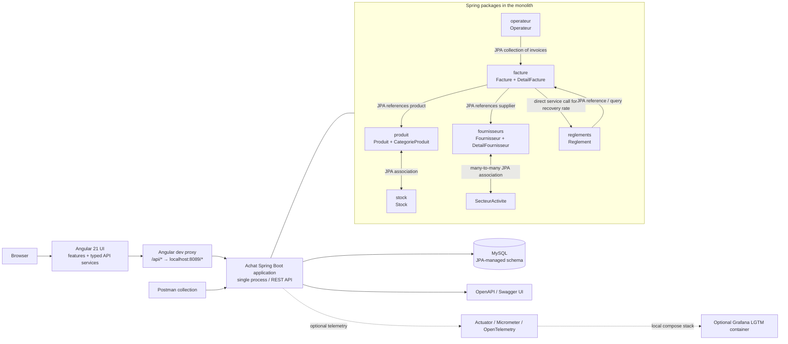
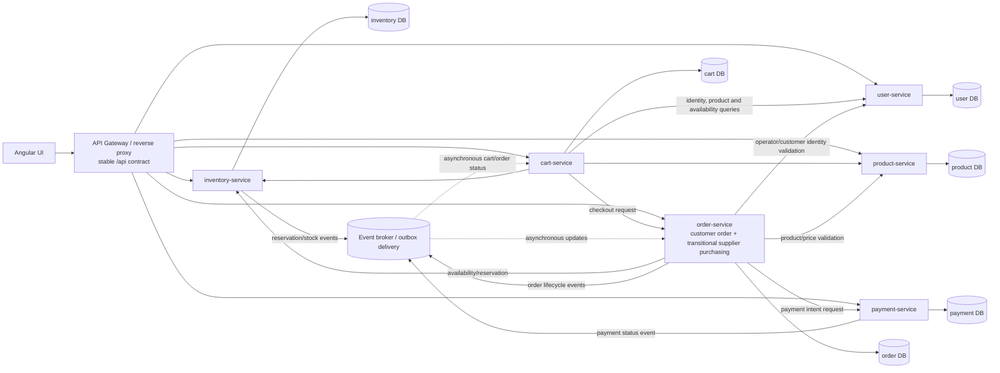

# Current Architecture Analysis and Microservice Migration Proposal

## 1. Executive summary and scope

This is a repository-based architecture analysis only. No application source,
configuration, build file, dependency, or business logic has been changed.

The current system is a **single Spring Boot purchasing/stock-management
application** with an Angular administration UI. It is not yet a customer
e-commerce application: there are no customer accounts, shopping carts, or
customer checkout orders. The existing `Facture` aggregate is attached to a
`Fournisseur` and contains purchased product lines and settlement records, so
it represents a supplier-side invoice/purchasing workflow rather than a
customer order. This distinction must be agreed before treating it as the
source for the new `order-service`.

The six requested services can be given workable initial boundaries, but
`user-service`, `cart-service`, and customer-order functionality are primarily
new capabilities. Supplier master data has no dedicated target among the six;
this analysis places it with `order-service` as a transitional procurement
boundary and calls out the resulting ownership decision.

## 2. Current architecture

The `Fournisseur` ↔ `SecteurActivite` edge denotes a JPA association between
entities in the same `fournisseurs` package; it is not a service call.

### 2.1 Backend structure and current modules

The backend has one application entry point, `AchatApplication`, and one
Maven-built Spring Boot deployment. Domain packages group the REST controllers,
entities, repositories, services, exceptions, and response records:

| Existing package | Current responsibility | Principal persisted entities |
|---|---|---|
| `org.example.achat.produit` | Product and product-category CRUD; product-to-stock assignment | `Produit`, `CategorieProduit` |
| `org.example.achat.stock` | Stock CRUD and a low-quantity report helper (not exposed by the current REST controller) | `Stock` |
| `org.example.achat.fournisseurs` | Supplier, supplier details, and business-sector CRUD/assignment | `Fournisseur`, `DetailFournisseur`, `SecteurActivite` |
| `org.example.achat.operateur` | Internal operator CRUD | `Operateur` |
| `org.example.achat.facture` | Supplier invoice retrieval/creation/cancellation, invoice-to-supplier/operator operations, recovery-rate reporting | `Facture`, `DetailFacture` |
| `org.example.achat.reglements` | Settlement/payment-record CRUD, invoice lookup, revenue reporting | `Reglement` |
| `org.example.achat.config` | Development-only security and data seeding | None |

Across the domain packages, the existing class families are:

- **Controllers:** `ProduitRestController`, `CategorieProduitController`,
  `StockRestController`, `FournisseurRestController`,
  `SecteurActiviteController`, `OperateurController`,
  `FactureRestController`, and `ReglementRestController`.
- **Services and interfaces:** `ProduitServiceImpl` / `IProduitService`,
  `CategorieProduitServiceImpl` / `ICategorieProduitService`,
  `StockServiceImpl` / `IStockService`,
  `FournisseurServiceImpl` / `IFournisseurService`,
  `SecteurActiviteServiceImpl` / `ISecteurActiviteService`,
  `OperateurServiceImpl` / `IOperateurService`,
  `FactureServiceImpl` / `IFactureService`, and
  `ReglementServiceImpl` / `IReglementService`.
- **Repositories:** `ProduitRepository`, `CategorieProduitRepository`,
  `StockRepository`, `FournisseurRepository`,
  `DetailFournisseurRepository`, `SecteurActiviteRepository`,
  `OperateurRepository`, `FactureRepository`,
  `DetailFactureRepository`, and `ReglementRepository`.
- **Response DTOs:** `ProduitResponse`, `CategorieProduitResponse`,
  `StockResponse`, `FournisseurResponse`, `SecteurActiviteResponse`,
  `OperateurResponse`, and `ReglementResponse`. Invoice endpoints currently
  expose JPA entities rather than a dedicated invoice response DTO.
- Domain-specific not-found exceptions and REST advice classes exist for
  products/categories, stocks, suppliers/sectors, operators, and settlements.
  The invoice package has no matching REST advice in the current inventory.

There are 67 main Java source files. Development bootstrap behavior is in
`DevelopmentDataSeeder`; it seeds products, categories, stocks, suppliers,
sectors, operators, invoices, invoice lines, and nested settlement records
from JSON resources. `DevelopmentSecurityConfig` is active only in the `dev`
profile.

The existing automated tests include application-context/Testcontainers
coverage and product/stock service/controller tests. The repository has no
equivalent visible test classes for invoices, suppliers, operators, or
settlements.

### 2.2 Technology, build, and runtime configuration

| Concern | Observed configuration |
|---|---|
| Java | Java 21 (`java.version` in the Maven project) |
| Spring Boot | 4.1.1 |
| Build | Maven; Maven Wrapper configured for Maven 3.10.0; no Gradle build |
| Web/API | Spring MVC, JSON/Jackson, Jakarta validation, SpringDoc OpenAPI UI 3.1.0 |
| Persistence | Spring Data JPA / Hibernate, MySQL Connector/J |
| Other backend dependencies | Spring Security, Actuator, OpenTelemetry starter, Micrometer Prometheus registry, Lombok |
| Test dependencies | Spring Boot test starters, Spring REST Docs, Mockito 5.23.0, Testcontainers for MySQL and Grafana LGTM |
| Spring Cloud | No Spring Cloud dependencies or Cloud infrastructure are configured |
| Application port | 8089 by default |
| Database | MySQL; backend README requires MySQL 8+, while Compose uses the mutable `mysql:latest` tag |
| Database/schema selection | `DB_URL` defaults to `jdbc:mysql://localhost:3306/achatdb?serverTimezone=UTC`; `DB_USERNAME` defaults to `achat_user`; the password is environment-driven |
| Schema lifecycle | `spring.jpa.hibernate.ddl-auto` defaults to `update`; no Flyway/Liquibase migrations or checked-in SQL schema were found |
| Hibernate web-session behavior | `spring.jpa.open-in-view=false`; repositories use fetch graphs for selected relations |
| Active profile | `dev` by default unless overridden with `SPRING_PROFILES_ACTIVE` |
| Development data | `DevelopmentDataSeeder` runs only under `dev` and only when `APP_SEED_ENABLED=true` (false by default) |
| API docs/health | Swagger UI and OpenAPI JSON; Actuator health/metrics endpoints are configured |

Spring Security is a declared dependency. The only explicit filter-chain
configuration found is `DevelopmentSecurityConfig`, which permits every
request and disables CSRF under the `dev` profile. There is no application
login/account API, password encoder, JWT/OAuth integration, or frontend token
handling. Outside `dev`, the repository has no application-defined security
policy; Spring Security auto-configuration remains relevant and must be
deliberately configured for production.

`backend/compose.yaml` starts MySQL and Grafana LGTM only; it does not build or
run the API or frontend. The Compose MySQL database-name default is
`mydatabase`, while the application JDBC URL defaults to `achatdb`. Compose
sets a root-password variable but does not configure the application’s default
non-root username, so the two defaults do not form a self-contained
application/database setup. The file uses mutable `latest` image tags.

No CI/CD workflow, service Dockerfile, Kubernetes/Helm deployment, or
production Compose deployment was found in the repository. The backend has a
Postman collection and example environment. OpenTelemetry and LGTM are present
as development/test infrastructure, not as a deployed microservice
observability architecture.

### 2.3 Current data model and logical table ownership

There is no explicit DDL or `@Table` mapping to treat as an authoritative
physical schema. The application relies on Hibernate naming conventions and
`ddl-auto=update`; the table names below are therefore logical entity/table
names to verify against the actual database before migration.

| Logical entity/table | Current fields/relationships of architectural significance |
|---|---|
| `Produit` | Product code, label, price, creation/modification dates; `ManyToOne` references to `Stock` and `CategorieProduit` |
| `CategorieProduit` | Product-category code and label; inverse collection of products |
| `Stock` | Stock label, quantity, minimum quantity; inverse product collection |
| `Fournisseur` | Supplier code/label/category; one-to-one `DetailFournisseur`; many-to-many `SecteurActivite`; inverse invoices |
| `DetailFournisseur` | Email, collaboration date, address, registration number; one-to-one supplier reference |
| `SecteurActivite` | Business-sector code and label; inverse supplier collection |
| `Operateur` | Name, first name, password field; unidirectional one-to-many invoice collection |
| `Facture` | Amount, discount, creation/modification dates, archived flag; invoice lines, supplier, and settlements |
| `DetailFacture` | Ordered quantity, totals/discount values; references `Produit` and `Facture` |
| `Reglement` | Paid/remaining amounts, paid flag, date; mandatory reference to `Facture` |
| ORM association tables | Hibernate-generated join tables may exist for supplier-sector membership and operator-invoice assignment; exact names/constraints are not declared in the repository |

The `Produit` ↔ `Stock` association is bidirectional in JPA, although product
owns the `ManyToOne` foreign key in the current mapping. `Fournisseur` ↔
`SecteurActivite` is a many-to-many association. `Operateur.factures` is a
unidirectional `OneToMany` to invoices, which commonly uses an ORM join table;
the exact generated schema should be inspected rather than inferred during
data extraction.

No customer/user account, cart, cart-line, inventory-reservation, or
customer-order table/entity currently exists. A `Reglement` is a payment
record, not an integration with an external payment provider.

### 2.4 Existing API and frontend dependencies

The frontend is Angular 21 with Angular Material, TypeScript 5.9, and RxJS 7.8;
its README documents Node.js 22.12+ (or 20.19+ / 24+) and npm.
Its `apiUrl` is `/api` in both environments. In development, the Angular CLI
proxy removes `/api` and forwards requests to `http://localhost:8089`; in
production, the README expects a reverse proxy to do the same, or an explicitly
configured remote URL with CORS. The UI currently has no login page or token
handling.

The Angular application has one typed client service per current resource:
`FactureService`, `ReglementService`, `ProduitService`,
`CategorieProduitService`, `StockService`, `FournisseurService`,
`SecteurActiviteService`, and `OperateurService`. Most CRUD services share
`CrudService`; invoice and settlement clients use custom endpoints. The
feature routes/screens cover invoices, settlements, products, product
categories, stocks, suppliers, business sectors, and operators.

The frontend contract depends on these current route families:

| UI resource | Current API paths/behavior |
|---|---|
| Products | `/produits` CRUD and `PUT /produits/{id}/stock/{stockId}` |
| Product categories | `/categories-produits` CRUD |
| Stocks | `/stocks` CRUD |
| Suppliers | `/fournisseurs` CRUD and supplier-sector assignment |
| Business sectors | `/secteurs-activite` CRUD |
| Operators | `/operateurs` CRUD |
| Settlements | `/reglements` read/detail/delete, lookup by invoice, and revenue over a date range |
| Invoices | `/facture/retrieve-all-factures`, `/retrieve-facture/{id}`, `/add-facture`, `/cancel-facture/{id}`, supplier lookup, operator assignment, recovery-rate report |

Compatibility constraints from the existing client and backend documentation:

- `POST`/`PUT /reglements` cannot currently bind a required invoice because
  `Reglement.facture` is ignored in JSON; the UI intentionally does not expose
  create/update actions.
- Invoice creation is not a complete order workflow: the current endpoint
  does not accept supplier or invoice-line relationships in its request body.
  Invoice cancellation is archival; there is no general edit/delete endpoint.
- Product category assignment is not exposed through the current write API.
- Unknown invoice detail currently yields a successful response with an empty
  body; the frontend converts that case to a client-side 404.
- The recovery-rate endpoint catches any exception and returns `0`, so an
  operational/reporting failure is indistinguishable from a genuine zero rate.
- Some entity relationships are hidden from JSON, while response records expose
  IDs instead. A gateway/strangler layer should preserve these contracts while
  routing traffic during migration.

## 3. Proposed six-service architecture

Each service should own its data store/schema and its write model. Cross-service
relationships should be identifiers and API/event contracts, not shared JPA
entities, repositories, tables, or cross-database foreign keys. A Spring Cloud
Gateway (or equivalent edge proxy) should remain the browser’s single API
entrypoint; it is infrastructure and is not one of the six domain services.

The diagram shows logical relationships, not a decision to make every
interaction synchronous. Prefer short request/response calls for validation
and commands, and durable events for lifecycle updates. In particular,
payment completion should be delivered as an idempotent event rather than a
second synchronous callback chain.

### 3.1 `user-service`

**Boundary:** Identity, authentication/authorization, customer profiles, and
internal operator profiles. `Operateur` is the only existing entity that could
be migrated here, and it represents staff/operators, not customers.

**Existing classes to migrate/adapt:**

- `OperateurController`, `OperateurExceptionHandler`
- `OperateurResponse`
- `Operateur`, `OperateurNotFoundException`
- `OperateurRepository`
- `IOperateurService`, `OperateurServiceImpl`

**Data ownership:** Migrate the current `Operateur` records/table as an
internal-staff profile. Add new account/profile and role/authority tables for
customer and staff identities as required; there is no current customer table.
Do not carry the existing invoice collection as a JPA relationship: the
order/purchasing service should retain an `operatorId` reference or immutable
assignment snapshot.

**Capabilities to add:** Registration and account lifecycle; authentication
and token issuance/validation or integration with an identity provider;
password hashing and reset/verification flows; roles/permissions; customer
profile APIs; authorization policies for staff vs. customers; audit of
identity-related changes.

**Dependencies:** Order-service needs identity/profile validation and may
retain operator assignment by user ID. Cart/order ownership requires a stable
customer ID. Product and inventory should not call user-service.

**Risks/overlap:** `Operateur.password` exists, but no password encoder,
authentication endpoint, JWT/OAuth integration, or user identity model was
found. Seeded/operator password values require a secure migration decision;
they must not be interpreted as safe credential hashes. Existing UI operator
CRUD is not a substitute for public customer identity APIs.

### 3.2 `product-service`

**Boundary:** Product catalog and category definitions, including catalog
attributes and pricing.

**Existing classes to migrate/adapt:**

- `ProduitRestController`, `CategorieProduitController`,
  `ProduitExceptionHandler`
- `ProduitResponse`, `CategorieProduitResponse`
- `Produit`, `CategorieProduit`
- `ProduitRepository`, `CategorieProduitRepository`
- `IProduitService`, `ProduitServiceImpl`,
  `ICategorieProduitService`, `CategorieProduitServiceImpl`
- `ProduitNotFoundException`, `CategorieProduitNotFoundException`

**Data ownership:** `Produit` and `CategorieProduit` tables. Remove the JPA
association to `Stock`; product should not own a cross-service inventory
entity. Preserve a product identifier and stable catalog data. If legacy API
compatibility requires returning a stock ID, return a projection/read-model
field sourced from inventory rather than a foreign key.

**Capabilities to add:** Product search/filter/pagination; category assignment
and lifecycle rules; product validation and price/description APIs for cart
and order checkout; product change events; an agreed pricing policy and
versioning/snapshot contract for order lines.

**Dependencies:** Cart and order consume product details/prices; inventory
uses the product ID as a reference, but product-service should not call
inventory synchronously to persist catalog changes. Product IDs must remain
stable or be explicitly remapped.

**Risks/overlap:** The current API cannot write the product category despite
the JPA field, and product-stock assignment is coupled to inventory. Current
price is a `float`; order/payment totals should use a defined currency and
decimal representation rather than introducing cross-service rounding drift.

### 3.3 `inventory-service`

**Boundary:** Stock locations/stock records, quantities, availability,
reservations, adjustments, and low-stock rules.

**Existing classes to migrate/adapt:**

- `StockRestController`, `StockExceptionHandler`, `StockResponse`
- `Stock`, `StockRepository`, `StockNotFoundException`
- `IStockService`, `StockServiceImpl`
- The inventory side of `Produit.stock` and `Stock.produits` associations must
  be replaced by product IDs/API contracts, not migrated as cross-service
  JPA associations.

**Data ownership:** Migrate the current `Stock` table. Add an inventory
position/item table keyed by `productId` and stock/location, plus reservation
records and an idempotency/command record as needed. The current schema stores
`qte` on `Stock` while linking a product to a stock; it does not clearly model
per-product quantity. Do not copy one stock quantity to every linked product
without a verified data rule.

**Capabilities to add:** Atomic reserve/release/consume operations; available
vs. reserved quantities; stock adjustment/audit trail; idempotent reservation
commands; low-stock events; explicit handling for concurrent checkout and
overselling.

**Dependencies:** Checkout/order requests inventory availability or
reservation using product IDs; catalog IDs are references only. Inventory
publishes reservation/stock state changes; product-service must not own or
update inventory quantities.

**Risks/overlap:** Current `StockServiceImpl` only provides CRUD and a
below-minimum report. Creating/cancelling invoices does not currently reserve
or decrement stock. The legacy one-product-to-one-stock shape may not match
the desired multi-warehouse inventory model; confirm this before defining the
new schema.

### 3.4 `cart-service`

**Boundary:** A customer’s mutable, pre-checkout basket and cart-line lifecycle.

**Existing classes to migrate:** None. No cart package, entity, repository,
controller, service, table, frontend route, or client model exists.

**Data ownership:** New `Cart` and `CartItem` tables (or equivalent document
model), keyed to a user/customer ID and product ID. Store quantity and
necessary display/price metadata only according to an explicit snapshot and
revalidation policy; the cart is not the authoritative product or inventory
record.

**Capabilities to add:** Create/retrieve/update/remove cart and lines; validate
quantities; merge or expire anonymous carts if guest shopping is required;
reprice/revalidate product availability; checkout handoff; cart clearing only
after order acceptance; abandoned-cart retention policy.

**Dependencies:** Uses user identity, product details/prices, and inventory
availability. Checkout initiates an order request. Do not make order-service
call cart-service synchronously during order placement; let cart react to an
accepted-order event or clear itself after receiving a successful checkout
result.

**Risks/overlap:** Cart availability is inherently a time-of-check/time-of-use
estimate. Order creation must revalidate and reserve stock, and must not trust
the cart’s client-supplied prices or availability.

### 3.5 `order-service`

**Boundary:** New customer order lifecycle plus, only as a transitional fit
for the fixed six-service target, the existing supplier/purchasing workflow.
Keep customer orders conceptually distinct from legacy supplier invoices.

**Existing classes to migrate/adapt:**

- Invoice/purchasing: `FactureRestController`,
  `Facture`, `DetailFacture`, `FactureRepository`,
  `DetailFactureRepository`, `IFactureService`, `FactureServiceImpl`
- Supplier and business sectors: `FournisseurRestController`,
  `SecteurActiviteController`, `FournisseurExceptionHandler`,
  `FournisseurResponse`, `SecteurActiviteResponse`,
  `Fournisseur`, `DetailFournisseur`, `CategorieFournisseur`,
  `SecteurActivite`, `FournisseurNotFoundException`,
  `SecteurActiviteNotFoundException`, `FournisseurRepository`,
  `DetailFournisseurRepository`, `SecteurActiviteRepository`,
  `IFournisseurService`, `FournisseurServiceImpl`,
  `ISecteurActiviteService`, `SecteurActiviteServiceImpl`
- The invoice/operator assignment endpoint and its current relation should
  become an `operatorId` reference, not a JPA relation to `Operateur`.

**Data ownership:** Migrate supplier/invoice tables and supplier-sector
association data here under the stated transitional boundary. Create separate
customer `Order`/`OrderLine` tables if customer checkout is introduced; do not
silently reinterpret `Facture` rows as sales orders. Order lines should
reference product IDs and preserve the agreed item name, unit-price, currency,
quantity, and discount snapshots needed to explain historical totals.

**Capabilities to add:** Customer order create/read/cancel/state transitions;
checkout validation and stock reservation; durable order lifecycle events;
operator/customer identifiers; customer order queries; explicit distinction
between purchasing invoice, sales order, and any legally required invoice
document.

**Dependencies:** Product validation/price, inventory reservation, user and
operator identifiers, and payment-intent creation. Supplier and
`SecteurActivite` data remain local if this transitional ownership is chosen.
Publish order-created/cancelled events; avoid direct database joins to product,
inventory, user, or payment.

**Risks/overlap:** `FactureServiceImpl` directly uses product, supplier,
operator, and settlement repositories/services. It also calls
`ReglementServiceImpl` to compute recovery rate, creating a direct
invoice/payment dependency. The recovery-rate report currently combines
invoice totals and payment revenue by date, including archived-invoice
conditions; its contract needs a reporting owner and cross-service data
strategy. `Facture` and `DetailFacture` responses expose entities, while
create only saves the submitted entity. A private pricing helper exists but is
not invoked by the shown create method. Preserve observed behavior during
strangler migration; treat any corrections as separate, approved changes.

**Boundary caveat:** Supplier master data is not a natural customer-order
aggregate. Keeping suppliers in `order-service` minimizes the number of
services and keeps existing purchasing behavior together, but if supplier
management remains a first-class domain, a later dedicated supplier service
or a separately retained procurement service may be cleaner than permanently
coupling supplier and customer order lifecycles.

### 3.6 `payment-service`

**Boundary:** Payment intents/attempts, settlement state, provider integration,
payment callbacks, refunds, and payment audit.

**Existing classes to migrate/adapt:**

- `ReglementRestController`, `ReglementExceptionHandler`,
  `ReglementResponse`
- `Reglement`, `ReglementNotFoundException`, `ReglementRepository`
- `IReglementService`, `ReglementServiceImpl`
- The payment calculation portion of the invoice recovery-rate report needs
  an explicit reporting contract; do not keep direct calls into
  `ReglementServiceImpl` from the migrated order-service.

**Data ownership:** Migrate `Reglement` records to payment-owned data. Replace
the relational `factureId` foreign key with a stable order/invoice reference
(`orderId` or explicitly typed legacy invoice ID); preserve historical
settlement references and paid amounts. Add payment-attempt/provider-reference
and idempotency data only for the chosen payment flow.

**Capabilities to add:** Provider adapter(s); create/authorize/capture/refund;
webhook signature verification; idempotent event processing; explicit
pending/succeeded/failed/refunded states; reconciliation and audit; safe
handling of retries and duplicate callbacks.

**Dependencies:** Order-service initiates payment against an order ID and
amount/currency. Payment emits a durable status event that order-service
consumes. Payment must not depend on order-service tables or issue a
synchronous callback that creates a fragile reciprocal request cycle.

**Risks/overlap:** The current `Reglement` is only a local record and has no
provider or settlement integration. `POST`/`PUT /reglements` are documented as
failing validation because the required `facture` relation is ignored by JSON.
The current revenue query joins settlements to invoice archive state in JPA;
that cross-service query cannot be retained as a database join after
ownership is split.

## 4. Cross-service dependency and responsibility summary

| Caller/owner | Dependency or shared concern | Recommended ownership rule |
|---|---|---|
| Cart → user | Cart ownership | User-service owns identity; cart stores `customerId` |
| Cart → product | Product display, price, active status | Product-service is authoritative; cart revalidates at checkout |
| Cart → inventory | Availability estimate | Inventory-service is authoritative; order checkout reserves atomically |
| Cart → order | Checkout | Cart submits a checkout request; no reciprocal synchronous order-to-cart dependency |
| Order → product | Product identity and price validation | Order stores product ID and historical line snapshot |
| Order → inventory | Reservation/consumption/release | Inventory owns quantities and reservation state |
| Order → user | Customer/operator references | Order stores stable IDs; user-service owns profile and credentials |
| Order → payment | Payment initiation | Payment owns payment state; completion is an event |
| Order ↔ payment reporting | Existing recovery-rate/revenue logic | Define a reporting projection/event feed; no cross-database join or shared repository |
| Order → supplier | Existing supplier invoice/purchase workflow | Transitional local supplier domain within order-service; revisit if it grows |

The clearest current circular/shared-responsibility hazards are:

1. **Product and inventory:** reciprocal JPA object references cannot cross
   service databases. Inventory should own stock and product IDs; catalog
   should own product metadata.
2. **Order and payment:** `Facture` references `Reglement`, `Reglement`
   references `Facture`, and recovery-rate code calls the payment service
   implementation directly. Replace the persistence cycle with IDs and
   event-driven status/reporting contracts.
3. **Order and user/operator:** `Operateur` currently exposes its invoices
   through a one-to-many relation; order assignment currently mutates that
   relation. Move assignment ownership to order and retain only an operator
   ID.
4. **Supplier and order meaning:** supplier invoices belong to purchasing,
   while a customer order is a different business process. Do not combine
   their schemas or state machines merely because both contain lines and
   totals.
5. **Cart and order:** ensure checkout is one-way from cart to order; use an
   order event or checkout response for cart state rather than a synchronous
   callback cycle.

## 5. Risks and migration challenges

1. **Domain gap and terminology:** This repository implements purchasing and
   stock administration. Customer, cart, customer order, and payment-provider
   behaviors are new requirements, not code that can be mechanically split.
2. **Legacy invoice semantics:** Confirm whether `Facture` is a supplier
   invoice, a purchase order, or a more generic internal invoice in business
   terminology. The current association to `Fournisseur` strongly indicates
   supplier-side purchasing. Establish whether the target `order-service`
   must own this workflow, new customer sales orders, or both.
3. **Database ownership:** Hibernate currently manages all entities in one
   MySQL schema. A service split requires a data-owner decision, an extraction
   plan, and a policy for historical reads. Do not keep shared tables or
   cross-schema entity mappings as an intermediate “microservice” state.
4. **Schema uncertainty:** No explicit DDL/migration scripts or `@Table`
   annotations were found. Capture actual production schema, indexes,
   constraints, join-table names, and representative data before planning
   table-level backfills.
5. **Cross-service transactions:** Invoice/order creation, inventory
   reservation, and payment are no longer one local transaction. Use explicit
   states, idempotent commands/events, outbox/inbox delivery, timeouts, and
   compensating releases/cancellations. Define the user-visible outcome for
   partial failure.
6. **Inventory model ambiguity:** `Stock.qte` is not represented per product
   despite products being assigned to stocks. Resolve this data-model issue
   with business owners before assigning quantities to inventory positions.
7. **Historical consistency:** Current invoice lines point to mutable product
   data and use floating-point amounts. New order lines need immutable
   snapshots and a defined decimal/currency strategy; migration must preserve
   historic totals instead of recalculating them from today’s catalog.
8. **Identifier and API compatibility:** Existing IDs are MySQL identity
   values and frontend DTOs/endpoints expose them. Decide whether IDs remain
   stable during backfill and maintain API adapters for existing paths until
   clients migrate.
9. **Authentication/security:** In `dev`, all requests are permitted and CSRF
   is disabled. No explicit production authentication/authorization
   implementation, token handling, or password encoder was found. The
   `Operateur` model has a password field. Define identity-provider/token
   architecture and secure credential migration before exposing new services.
10. **Configuration and deployment:** Compose is only a local MySQL/observability
    starter, has a database-name mismatch with the application default, and
    uses mutable image tags. There are no current per-service containers,
    deployment descriptors, or CI workflows.
11. **Cloud compatibility:** Spring Cloud is not present. Select a Spring
    Cloud release train explicitly compatible with the chosen Spring Boot
    4.x version using its official compatibility matrix before adding Gateway,
    discovery, or Config dependencies. Do not assume compatibility from the
    current Boot/SpringDoc/Testcontainers versions.
12. **Observability and operations:** Actuator, Prometheus, and OpenTelemetry
    dependencies exist, but service identity, distributed trace propagation,
    log correlation, dashboards, alerting, and production collection/export
    are not defined.
13. **Test and release coverage:** Current visible tests cover only selected
    product/stock operations plus application context startup. Each extracted
    service will need contract, persistence, migration, and integration tests;
    cross-service workflows need failure/retry tests.
14. **Development seeding:** The current seeder is one transactional
    `ApplicationRunner` that loads several domains together, including nested
    payments from invoice seed data. It cannot simply be copied into every
    service; seed ownership and repeatable fixtures must be separated.
15. **Frontend routing/CORS:** The browser currently uses one `/api` origin
    and a dev proxy. Direct browser-to-service URLs would multiply CORS and
    authentication concerns. Keep the gateway/reverse proxy as the stable
    frontend boundary and route legacy paths during migration.

## 6. Recommended migration order

Use an incremental strangler migration. Keep the existing API and its behavior
available until a replacement service has data parity, contract tests, and a
verified route switch. The order below is dependency-based; the first two
domain services can proceed in parallel if their IDs/contracts are fixed.

1. **Architecture and contract baseline (before moving data):** Decide the
   customer-order vs. supplier-invoice terminology and supplier ownership;
   capture actual schema/data; inventory endpoint/DTO contracts; define IDs,
   monetary representation, API versioning, data-owner boundaries, event
   envelope, and recovery-rate/reporting behavior. Choose compatible Spring
   Cloud versions and deployment/observability conventions.
2. **`user-service` foundation:** Establish identity and authorization design,
   migrate operator profiles safely, and define customer accounts (if
   required). Keep order assignments as IDs. This creates a secure identity
   dependency for new customer-facing flows.
3. **`product-service`:** Move catalog/category data and preserve current
   product API contracts. Freeze product identifiers and decouple the
   `Produit.stock` JPA relation at the service boundary.
4. **`inventory-service`:** Move stock data after product IDs and the
   stock-per-product model have been agreed. Add reservation semantics before
   routing checkout/order writes to it. Product and inventory can be
   implemented in parallel only if their API and data ownership contracts are
   agreed first.
5. **`order-service`:** First migrate the current supplier/purchasing invoice
   workflow without silently changing its semantics; replace direct
   repository/service references with product, inventory, user, and payment
   contracts. Add customer order creation as a distinct aggregate/state
   machine only after its requirements are defined.
6. **`payment-service`:** Migrate settlement history, then introduce payment
   provider flows, idempotent webhooks, and order-status events. Make recovery
   reporting use a deliberate read model rather than a cross-service
   transactional query.
7. **`cart-service`:** Build the new cart capability on stable user/product/
   inventory contracts and connect checkout to the order API. Since no cart
   exists today, this is feature delivery, not a data extraction.
8. **Route cutover and retirement:** Route Angular/Postman traffic through the
   gateway while preserving old paths, test end-to-end workflows and failure
   cases, compare migrated records and reports, then retire monolith-owned
   writes/table ownership only after explicit acceptance.

At steps 2–6, move one data owner at a time: backfill, validate counts and
financial totals, synchronize writes only for a controlled transition period,
and then remove the old write path. Avoid permanent dual writes from the
monolith to multiple service databases.

## 7. Dependency and compatibility recommendations

- **Spring Cloud alignment:** The application is on Spring Boot 4.1.1 and has
  no Spring Cloud BOM/starters. Verify the official Spring Cloud release-train
  compatibility matrix for the selected Boot version first. Pin a coherent
  BOM; do not independently guess Gateway, Config, or discovery starter
  versions.
- **Spring Boot 4 migration:** The current build already uses Boot 4-era
  starters such as `spring-boot-starter-webmvc` and Boot-specific test
  starters. Keep service starters and Spring Cloud integrations aligned with
  this generation; do not substitute older Boot 3 examples without checking
  artifact/API compatibility.
- **Service-to-service contracts:** Publish versioned HTTP/event contracts
  using service-owned DTOs. Avoid shared persistence entities or a shared
  mutable “common domain” module. A small versioned contract library can be
  considered only for stable wire types, not JPA models.
- **Persistence/migrations:** Replace `ddl-auto=update` for independently
  owned service schemas with reviewed, versioned schema migrations. Confirm
  the actual Hibernate-generated table/association names and MySQL version
  before extraction.
- **Gateway/frontend:** Preserve a single `/api` browser origin; map legacy
  Angular routes to their owning service at the gateway. Introduce token
  forwarding only after selecting the user/identity model. Avoid permissive
  `@CrossOrigin("*")` as the production boundary.
- **Data contracts:** Define stable IDs, ISO currency, decimal precision,
  timestamp/time-zone policy, error format, pagination, and API/event version
  policy before independently releasing services.
- **Runtime compatibility:** Pin MySQL and observability image versions,
  provide per-service health/readiness and resource settings, and align
  Testcontainers versions/images with supported runtime versions. Compose
  should eventually represent local service dependencies, not use `latest`
  tags.
- **Delivery:** Add a build/test/package pipeline and service/container
  deployment definitions as part of the migration foundation; none are
  present in the current repository.

## 8. Repository references

- Backend build and dependencies: [`backend/pom.xml`](../../backend/pom.xml)
- Backend runtime settings: [`backend/src/main/resources/application.properties`](../../backend/src/main/resources/application.properties)
- Development security: [`backend/src/main/java/org/example/achat/config/DevelopmentSecurityConfig.java`](../../backend/src/main/java/org/example/achat/config/DevelopmentSecurityConfig.java)
- Development data seeding: [`backend/src/main/java/org/example/achat/config/DevelopmentDataSeeder.java`](../../backend/src/main/java/org/example/achat/config/DevelopmentDataSeeder.java)
- Local infrastructure: [`backend/compose.yaml`](../../backend/compose.yaml)
- Backend setup/API notes: [`backend/README.md`](../../backend/README.md)
- Frontend API proxy: [`frontend/proxy.conf.json`](../../frontend/proxy.conf.json)
- Frontend API services: [`frontend/src/app/core/services/`](../../frontend/src/app/core/services/)
- Frontend environment URLs: [`frontend/src/environments/`](../../frontend/src/environments/)
- Frontend feature/API documentation: [`frontend/README.md`](../../frontend/README.md)
