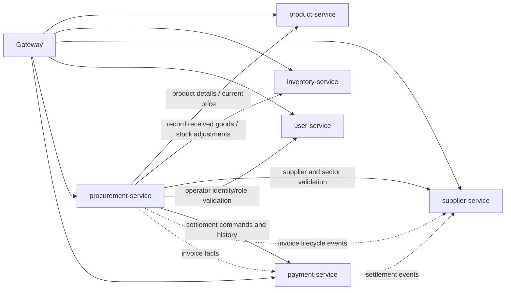

# Revised Target Architecture: Six Purchasing Microservices

**Architecture status:** Revised six-service purchasing boundaries and
platform decisions remain the target design; diagrams describe intended
ownership, not proof of runtime integration or production readiness.

**Implementation evidence (2026-11-17):** Standalone Product, Inventory,
Supplier, User, Procurement, and Payment projects now exist. Independent
build/test evidence, local ports, configured routes, implemented endpoints,
and unresolved cutover gaps are tracked in
[`../MICROSERVICES-IMPLEMENTATION-STATUS.md`](../MICROSERVICES-IMPLEMENTATION-STATUS.md).
No production data has been migrated, and Gateway route configuration does
not mean any service is an accepted authoritative replacement.

This document supersedes the proposed service boundaries in
[`01-current-architecture-analysis.md`](./01-current-architecture-analysis.md).
The repository is a purchasing and stock-management system. The target is
exactly six **business** microservices; Config Server, Eureka, Gateway,
observability tools, and any Axon infrastructure are platform components and
do not count as additional business services.

## 1. Target architecture

```mermaid
flowchart TB
    Angular["Existing Angular frontend<br/>same-origin /api"]
    Gateway["Spring Cloud Gateway<br/>legacy routes + new internal routes"]
    Config["Spring Cloud Config Server"]
    Eureka["Eureka Discovery Server"]

    subgraph Business["Exactly six independent Spring Boot business services"]
        Product["product-service"]
        Inventory["inventory-service"]
        Supplier["supplier-service"]
        User["user-service"]
        Procurement["procurement-service<br/>Axon CQRS"]
        Payment["payment-service"]
    end

    ProductDB[("product MySQL DB")]
    InventoryDB[("inventory MySQL DB")]
    SupplierDB[("supplier MySQL DB")]
    UserDB[("user MySQL DB")]
    ProcurementDB[("procurement MySQL DB")]
    PaymentDB[("payment MySQL DB")]

    Prometheus["Prometheus"]
    Grafana["Grafana"]
    Zipkin["Zipkin"]
    EventTransport["Durable integration-event transport<br/>or transactional outbox relays"]

    Angular -->|"legacy /api/* contract"| Gateway
    Gateway --> Product
    Gateway --> Inventory
    Gateway --> Supplier
    Gateway --> User
    Gateway --> Procurement
    Gateway --> Payment

    Config -. external configuration .-> Gateway
    Config -. external configuration .-> Product
    Config -. external configuration .-> Inventory
    Config -. external configuration .-> Supplier
    Config -. external configuration .-> User
    Config -. external configuration .-> Procurement
    Config -. external configuration .-> Payment
    Gateway -. registers / discovers routes .-> Eureka
    Product -. registers / discovers .-> Eureka
    Inventory -. registers / discovers .-> Eureka
    Supplier -. registers / discovers .-> Eureka
    User -. registers / discovers .-> Eureka
    Procurement -. registers / discovers .-> Eureka
    Payment -. registers / discovers .-> Eureka

    Product --> ProductDB
    Inventory --> InventoryDB
    Supplier --> SupplierDB
    User --> UserDB
    Procurement --> ProcurementDB
    Payment --> PaymentDB

    Procurement -->|"OpenFeign: product lookup"| Product
    Procurement -->|"receipt / stock-adjustment commands"| Inventory
    Procurement --> Supplier
    Procurement --> User
    Procurement -->|"settlement command/query contract"| Payment
    Procurement -->|"invoice lifecycle events"| EventTransport
    Payment -->|"consumes invoice facts;<br/>publishes settlement events"| EventTransport
    Supplier -->|"consumes procurement/payment facts<br/>for performance projections"| EventTransport

    Product -. metrics scrape .-> Prometheus
    Inventory -. metrics scrape .-> Prometheus
    Supplier -. metrics scrape .-> Prometheus
    User -. metrics scrape .-> Prometheus
    Procurement -. metrics scrape .-> Prometheus
    Payment -. metrics scrape .-> Prometheus
    Prometheus --> Grafana
    Product -. distributed traces .-> Zipkin
    Inventory -. distributed traces .-> Zipkin
    Supplier -. distributed traces .-> Zipkin
    User -. distributed traces .-> Zipkin
    Procurement -. distributed traces .-> Zipkin
    Payment -. distributed traces .-> Zipkin
    Gateway -. distributed traces .-> Zipkin
```

Each business service owns its schema and database credentials. No service
imports another service's JPA entities or repositories, and no foreign key
crosses a service boundary. REST calls use service contracts; durable business
facts use an explicitly selected message transport or an outbox relay. The
event transport and Axon Server, if selected, are infrastructure and do not
change the six-service count.

### 1.1 Service dependency diagram

The solid arrows represent bounded REST interactions, normally implemented
with OpenFeign. Dotted arrows are asynchronous facts used to build projections.
Supplier performance is computed from its own supplier master data plus
procurement and settlement facts; supplier-service does not synchronously call
procurement or payment. A durable event-fed Payment invoice projection remains
a possible future replacement for the implemented synchronous eligibility and
aggregate reads, subject to an approved transport and consistency policy.

Avoid reciprocal synchronous dependencies between Procurement and Payment.
The implemented direction is Payment → Procurement: Payment validates invoice
eligibility before settlement writes and reads invoice totals for recovery
reporting; Procurement does not call Payment. The Gateway preserves the legacy
`/facture/pourcentageRecouvrement/{startDate}/{endDate}` URL while routing it
to Payment. Eligibility currently means that the invoice exists and is not
archived; outstanding-balance and currency rules remain undefined. Durable
invoice/settlement events and reconciliation are still future work.

Inventory reservations are a distinct stock-allocation capability. A supplier
invoice or approval must not automatically reserve existing stock or increase
on-hand quantity. If procurement gains a goods-receiving step, it can send an
idempotent receipt/stock-adjustment command to inventory after the receipt is
confirmed. Reservation use cases and their authorized caller should be
specified separately.

## 2. Responsibilities and existing-class assignment

Paths below are relative to
`backend/src/main/java/org/example/achat/`. "Migrate/adapt" means transfer
ownership while preserving current behavior and wire contracts where required;
it does not authorize changing business rules. Controller and DTO names may be
retained initially to minimize API changes.

### 2.1 `product-service`

**Owns:** Product catalog, categories, product validation, and catalog pricing.
It is the authoritative source for product IDs and current product metadata.

**Existing classes to migrate/adapt:**

- `produit/controllers/ProduitRestController.java`
- `produit/controllers/CategorieProduitController.java`
- `produit/controllers/ProduitExceptionHandler.java`
- `produit/dto/ProduitResponse.java`,
  `produit/dto/CategorieProduitResponse.java`
- `produit/entities/Produit.java`,
  `produit/entities/CategorieProduit.java`
- `produit/repositories/ProduitRepository.java`,
  `produit/repositories/CategorieProduitRepository.java`
- `produit/services/IProduitService.java`,
  `produit/services/ProduitServiceImpl.java`,
  `produit/services/ICategorieProduitService.java`,
  `produit/services/CategorieProduitServiceImpl.java`
- `produit/exceptions/ProduitNotFoundException.java`,
  `produit/exceptions/CategorieProduitNotFoundException.java`

**Database ownership:** Product and category tables, including their
same-service category/product relationship. Do not retain a JPA relation to
`Stock`. Product IDs are passed to inventory and procurement as values.

**Additions:** Stable catalog lookup by ID/code, batch lookup for invoice
processing, optional product change events, and an agreed price/rounding
contract. Category write support can be added as a new capability, but must
not silently change the legacy API during extraction.

**Boundary:** Product-service does not own quantity-on-hand, reservations, or
stock movements. The existing `PUT /produits/{id}/stock/{stockId}` contract
must be routed or adapted to inventory ownership during migration; it must
not persist a cross-service association.

### 2.2 `inventory-service`

**Owns:** Stocks/locations, stock movements, available quantity, reservation
lifecycle, and low-stock alerts.

**Existing classes to migrate/adapt:**

- `stock/controllers/StockRestController.java`,
  `stock/controllers/StockExceptionHandler.java`
- `stock/dto/StockResponse.java`
- `stock/entities/Stock.java`
- `stock/repositories/StockRepository.java`
- `stock/services/IStockService.java`,
  `stock/services/StockServiceImpl.java`
- `stock/exceptions/StockNotFoundException.java`
- Remove the cross-service JPA association from `stock/entities/Stock.java`
  and the inverse association from `produit/entities/Produit.java`; replace
  with product IDs in inventory-owned records and service contracts.

**Database ownership:** Stock/location records and new inventory-position,
movement, reservation, and low-stock-alert records. Inventory records refer
to `productId` as an ordinary identifier, with no product database foreign
key.

**Additions:** Audited stock adjustments/movements; atomic reserve, release,
and consume commands for explicit allocation workflows; idempotency keys;
available-versus-reserved quantities;
threshold alert lifecycle; and concurrency protection to avoid overselling.

**Boundary:** Procurement owns the purchase invoice. Inventory owns only the
physical/available stock state. Creating or approving an invoice must not be
assumed to reserve, receive, or add stock until the corresponding workflow is
explicitly specified and confirmed.

### 2.3 `supplier-service`

**Owns:** Supplier master data, supplier details, business sectors, and
supplier-performance projections.

**Existing classes to migrate/adapt:**

- `fournisseurs/controllers/FournisseurRestController.java`,
  `fournisseurs/controllers/SecteurActiviteController.java`,
  `fournisseurs/controllers/FournisseurExceptionHandler.java`
- `fournisseurs/dto/FournisseurResponse.java`,
  `fournisseurs/dto/SecteurActiviteResponse.java`
- `fournisseurs/entities/Fournisseur.java`,
  `fournisseurs/entities/DetailFournisseur.java`,
  `fournisseurs/entities/SecteurActivite.java`,
  `fournisseurs/entities/CategorieFournisseur.java`
- `fournisseurs/repositories/FournisseurRepository.java`,
  `fournisseurs/repositories/DetailFournisseurRepository.java`,
  `fournisseurs/repositories/SecteurActiviteRepository.java`
- `fournisseurs/services/IFournisseurService.java`,
  `fournisseurs/services/FournisseurServiceImpl.java`,
  `fournisseurs/services/ISecteurActiviteService.java`,
  `fournisseurs/services/SecteurActiviteServiceImpl.java`
- `fournisseurs/exceptions/FournisseurNotFoundException.java`,
  `fournisseurs/exceptions/SecteurActiviteNotFoundException.java`

**Database ownership:** Supplier, supplier-detail, and sector tables, plus the
supplier/sector join table. Supplier performance is a supplier-owned
read-model/projection, not a foreign-key relationship to procurement or
payment tables.

**Additions:** A supplier performance API and documented metrics such as
on-time delivery, invoice discrepancy, or purchasing volume. The source
events, date window, missing-data behavior, and calculation policy must be
agreed before implementation; none of these metrics currently exist.

**Dependencies:** Procurement uses OpenFeign to validate/read supplier
references and publishes invoice lifecycle/receiving facts. Payment publishes
settlement facts if supplier performance includes payment timeliness. The
supplier service consumes these facts idempotently and does not own invoices
or settlements.

### 2.4 `user-service`

**Owns:** Internal operator profiles, authentication, JWT issuance/validation,
roles, and permissions. This service is for staff identity in the existing
purchasing domain; customer accounts are not required by the revised business
scope.

**Existing classes to migrate/adapt:**

- `operateur/controllers/OperateurController.java`,
  `operateur/controllers/OperateurExceptionHandler.java`
- `operateur/dto/OperateurResponse.java`
- `operateur/entities/Operateur.java`
- `operateur/repositories/OperateurRepository.java`
- `operateur/services/IOperateurService.java`,
  `operateur/services/OperateurServiceImpl.java`
- `operateur/exceptions/OperateurNotFoundException.java`
- `config/DevelopmentSecurityConfig.java` is a development-only behavior
  reference, not a production security configuration to copy. Replace it with
  explicit authentication/authorization policies for the user-service and
  all protected services.

**Database ownership:** Operator profiles, credential verifiers, role and
permission assignments, and security/audit records. Do not migrate
`Operateur.factures` as a JPA relationship. Procurement stores `operatorId` as
an identifier on assignments/approval records.

**Additions:** Login/token refresh/revocation policy; short-lived signed JWTs;
role/permission administration; secure password hashing and reset/rotation;
JWKS or equivalent public-key distribution; operator lockout/audit policy;
and service-to-service credentials. The current entity's `password` field is
not evidence of an existing authentication mechanism or safely hashed data.

**Dependencies:** Gateway verifies JWTs before routing; protected services
also validate token signature, issuer, audience, and authorities rather than
trusting arbitrary identity headers. Procurement may use an internal Feign
lookup when it needs to validate an operator assignment; ordinary caller
identity should come from authenticated claims.

### 2.5 `procurement-service`

**Owns:** Existing supplier invoices and invoice details, purchase workflows,
approval, invoice lifecycle, and invoice read projections. This service uses
Axon Framework for CQRS; the CQRS model is contained within this service and
does not create another business service.

**Existing classes to migrate/adapt:**

- `facture/controllers/FactureRestController.java`
- `facture/entities/Facture.java`, `facture/entities/DetailFacture.java`
- `facture/repositories/FactureRepository.java`,
  `facture/repositories/DetailFactureRepository.java`
- `facture/services/IFactureService.java`,
  `facture/services/FactureServiceImpl.java`
- Invoice-specific DTOs do not currently exist; preserve current serialized
  response shapes initially, then introduce explicit versioned DTOs behind
  compatibility adapters.
- `FactureServiceImpl` currently imports repositories/services from product,
  supplier, operator, and payment packages. Replace those in-process
  dependencies with the contracts in Section 5; do not move those external
  repositories/entities into procurement.

**Database ownership:** Invoice and invoice-line tables, approval/workflow
state, audit history, and procurement read projections. `supplierId`,
`operatorId`, and `productId` are plain identifiers. If Axon event storage is
enabled, it is procurement-owned (for example via a compatible persistence
implementation) or uses the separately operated Axon Server; it must not
become a shared business database.

**Additions:** Draft/submit/approve/reject/cancel lifecycle, approval policy,
audit trail, purchase-order receiving linkage if required, and CQRS command
and query models. Existing invoice creation/cancellation and amount behavior
must first be captured by characterization tests and preserved; approval
workflows are new behavior and require explicit acceptance criteria.

**Dependencies:** OpenFeign to Product, Supplier, and User. Inventory
receiving is deferred until its command and confirmed-receipt workflow are
approved. Procurement exposes internal invoice eligibility and total queries
for Payment and does not synchronously call Payment. Publish invoice lifecycle
facts for reconciliation and supplier performance after a durable event
transport is approved. Use Axon command/event handling for procurement
consistency; do not imply that Axon supplies cross-service ACID transactions.

### 2.6 `payment-service`

**Owns:** Existing invoice settlements, settlement history, payment tracking,
and reconciliation. The term payment here is the purchasing-side settlement
of supplier invoices, not customer checkout or a card payment gateway.

**Existing classes to migrate/adapt:**

- `reglements/controllers/ReglementRestController.java`,
  `reglements/controllers/ReglementExceptionHandler.java`
- `reglements/dto/ReglementResponse.java`
- `reglements/entities/Reglement.java`
- `reglements/repositories/ReglementRepository.java`
- `reglements/services/IReglementService.java`,
  `reglements/services/ReglementServiceImpl.java`
- `reglements/exceptions/ReglementNotFoundException.java`
- The legacy recovery-rate URL is served by a Payment compatibility endpoint
  and obtains active invoice totals from Procurement through an internal
  query. The Gateway retains the old browser URL; Procurement does not call
  Payment.

**Database ownership:** Settlement/payment-tracking records, reconciliation
batches, and payment audit. Replace `Reglement.facture` JPA mapping with an
`invoiceId` value and, if necessary, an invoice reference/status projection
fed by procurement events. No foreign key to procurement tables.

**Additions:** Reconciliation/import workflows, idempotent settlement intake,
duplicate detection, correction/reversal audit, unmatched-settlement handling,
and payment status queries. Do not add a card-provider integration unless
business requirements specifically require it.

**Dependencies:** Procurement can submit settlement commands and query
settlement history through REST. Payment consumes invoice lifecycle facts to
validate invoice references and reconcile state. The API must continue to
distinguish valid zero revenue from errors; do not retain the legacy
success-shaped catch-all fallback when replacing contracts without explicit
approval.

### 2.7 Monolith-level and existing test classes

These classes do not belong in a business service as-is:

- `AchatApplication.java` remains the entry point for the legacy monolith
  during strangler migration. It is retired only after all route and data
  ownership cutovers are accepted.
- `config/DevelopmentDataSeeder.java` currently writes across all six
  domains. Split its fixtures and initialization by data owner; do not run the
  monolith's cross-domain seeder against service-owned databases.
- `AchatApplicationTests.java`, `TestAchatApplication.java`, and
  `TestcontainersConfiguration.java` are monolith integration-test support.
  Replace their broad startup assumptions with per-service tests and retain
  end-to-end migration tests at the system boundary rather than copying the
  same global container setup into every service.
- Existing stock controller/service tests belong with
  `inventory-service`; existing product controller/service tests belong with
  `product-service`. Expand characterization and contract coverage for
  supplier, operator, procurement, and payment behavior before their
  respective cutovers.

## 3. Database ownership and cross-service rules

| Service | Independent MySQL database (logical name) | Owned data |
|---|---|---|
| `product-service` | `product_db` | Products, categories |
| `inventory-service` | `inventory_db` | Stock/locations, product inventory positions, movements, reservations, alerts |
| `supplier-service` | `supplier_db` | Suppliers, details, sectors, association table, performance projections |
| `user-service` | `user_db` | Operators, credential hashes, roles, permissions, security audit |
| `procurement-service` | `procurement_db` | Supplier invoices, invoice lines, purchase workflow, approvals, Axon-owned state/event data or projections |
| `payment-service` | `payment_db` | Invoice settlements, reconciliation, payment tracking/audit, invoice reference projection |

These are six separate database ownership boundaries, not six schemas that all
services may access. Each service receives separate credentials and
schema-migration ownership. For stronger fault and security isolation, deploy
separate MySQL instances; a single MySQL server with six separately permissioned
databases is a possible transitional deployment, but does not provide
instance-level isolation.

**No shared persistence model:**

- Remove `Produit.stock` and `Stock.produits` cross-service ORM links.
- Remove `Operateur.factures` cross-service ORM link.
- Replace `Facture.fournisseur`, `DetailFacture.produit`, and
  `Reglement.facture` cross-service relations with IDs and owned snapshots.
- Replace `Facture.reglements` with a payment query/projection if a use case
  needs settlement details.
- Never share service entity classes in a common library or run cross-service
  SQL/JPA joins.

**Data migration safeguards:** Confirm actual deployed table/join-table names
and data first; preserve existing generated IDs or define explicit mappings;
copy financial history without recomputing it from current products; compare
row counts, totals, and representative relationships before switching writes.
Split `DevelopmentDataSeeder` by data owner so each database can be initialized
and tested independently.

## 4. Frontend compatibility and Gateway routing

The current Angular frontend uses `apiUrl: '/api'`. Its development proxy
strips `/api` and forwards to port 8089; production expects a reverse proxy
with the same behavior. Keep the frontend unchanged initially. Put Spring
Cloud Gateway at the existing frontend-facing port/reverse-proxy destination,
and move the monolith to an internal port/network address while it remains
available as a fallback.

### 4.1 Legacy route mapping

Gateway predicates match the path and forward the same path and HTTP method
unless a compatibility filter is explicitly required. Use Eureka
service discovery/load balancing (`lb://...`) after each service is
registered. During transition, the not-yet-extracted route continues to target
the monolith. Do not expose service hostnames directly to the browser.

| Existing path family | Final route owner | Initial compatibility behavior |
|---|---|---|
| `/produits/**` | `product-service` | Preserve CRUD paths and response fields; reroute after product data parity |
| `/categories-produits/**` | `product-service` | Preserve although not in the abbreviated compatibility list; Angular uses it |
| `/stocks/**` | `inventory-service` | Preserve stock CRUD; inventory writes stay authoritative |
| `/fournisseurs/**` | `supplier-service` | Preserve supplier CRUD and sector assignment |
| `/secteurs-activite/**` | `supplier-service` | Preserve although not in the abbreviated compatibility list; Angular uses it |
| `/operateurs/**` | `user-service` | Preserve operator administration paths; require approved staff auth policy |
| `/facture/pourcentageRecouvrement/**` | `payment-service` | Preserve this legacy reporting URL through a more-specific Gateway route; Payment queries Procurement totals |
| `/facture/**` | `procurement-service` | Preserve the remaining supplier-invoice route spellings and behavior |
| `/reglements/**` | `payment-service` | Preserve settlement list/detail/delete, invoice lookup, and revenue routes |

Gateway should maintain separate explicit routes for each prefix rather than
one broad `/api/**` route to a service. Preserve method, status, content type,
date formatting, and legacy response serialization. Route `/api/**` only if a
specific fallback strategy is defined. The Gateway should not aggregate
multi-service write transactions or conceal service failures with fabricated
success responses.

**Repository routing status:** `config-repo/api-gateway.yml` now contains
explicit Eureka routes for each of the six legacy path families above, then
retains the `/api/**` monolith fallback. The rule has not been validated
against a running Eureka/Gateway/service environment. User and Payment
routes remain development/integration configuration only until authentication,
authorization, and payment eligibility/reporting contracts are accepted.

### 4.2 Cutover sequence

1. Keep `apiUrl`, Angular models, and route paths unchanged; point the existing
   `/api` proxy/reverse proxy at Gateway.
2. Initially send every legacy prefix to the still-running monolith. Verify
   that the Gateway preserves current contracts and auth behavior.
3. Extract one domain at a time; backfill and reconcile its database; change
   only that route to its service; keep the monolith running for unmigrated
   paths and controlled rollback.
4. Once a service is authoritative, stop monolith writes to its old tables.
   Do not permanently dual-write.
5. Update the frontend only when new workflow endpoints or a deliberate API
   version require it. Keep legacy routes as Gateway adapters until consumers
   have migrated and acceptance tests pass.

Authentication is the intentional contract change requiring coordinated
rollout: first establish operator accounts/roles and token validation, then
enable protected routes. The Gateway should validate JWT issuer, signature,
expiry, and audience; downstream services must enforce authorization for
sensitive actions and not rely on spoofable identity headers.

## 5. REST and event communication contracts

All inter-service REST APIs should be versioned and expressed as service-owned
request/response DTOs. IDs cross boundaries as scalar values. No API payload
contains a JPA entity. Suggested internal endpoints below are contracts to
design, not implemented APIs.

| Caller → owner | Suggested request/response contract | Purpose |
|---|---|---|
| procurement → product | Implemented OpenFeign call to the existing `GET /produits/{productId}` → `idProduit`, `codeProduit`, `libelleProduit`, `prix`, `stockId`, `categorieProduitId` | Resolve line products and store the returned snapshot; no currency/version fields are currently available |
| procurement → supplier | `GET /internal/v1/suppliers/{supplierId}` → supplier ID, active state, required purchasing terms | Validate supplier reference |
| procurement → inventory | If receiving is approved as a business workflow: `POST /internal/v1/receipts` with idempotency key, invoice/workflow ID, product IDs, received quantities; inventory returns the recorded receipt/movement. Reservation commands are a separate inventory contract. | Update inventory only after confirmed receipt; do not reserve existing stock or imply receipt from invoice approval |
| procurement → user | `GET /internal/v1/operators/{operatorId}` or an authorization-aware equivalent → active operator/role summary | Validate operator assignment or approver eligibility |
| payment → procurement | Implemented `GET /internal/v1/invoices/{invoiceId}/payment-eligibility` → `{ invoiceId, eligible, reasonCode }`; `GET /internal/v1/invoices/total?startDate=...&endDate=...` → `{ total }` | Fail closed for missing/archived invoices and obtain report denominator; no cross-service database access |
| Gateway → user | Existing `/operateurs/**`; new `/auth/**` and `/internal/v1/...` APIs as needed | Staff management and authentication |
| Gateway → each owner | Existing public route families in Section 4; optional new `/api/v1/...` routes | Preserve browser contract and add versioned capabilities |

The current backend stores prices and amounts as `float` and has no explicit
currency contract. The first implementation must document the existing
interpretation, preserve historical amounts, and define a compatible decimal
and currency policy before adding new financial calculations. Do not silently
change legacy totals as part of extraction.

### 5.1 Reliability policy

- Configure OpenFeign clients with explicit connection/read timeouts,
  authentication, request correlation, and typed error mapping.
- Apply Resilience4j circuit breakers/bulkheads and bounded retries to
  appropriate reads. Use idempotency keys for retryable commands.
- Do not return an empty product, valid invoice, accepted reservation, or
  successful settlement as a fallback when a dependency is unavailable.
- Inventory reservation and payment/settlement commands fail closed when
  ownership or idempotency cannot be established; a retry must not duplicate
  stock or money.
- Avoid retrying non-idempotent POST operations unless the request is
  explicitly idempotent.
- Propagate trace/correlation IDs across Gateway, Feign, event handlers, and
  scheduled reconciliation.

### 5.2 Integration events and CQRS

The following are candidate facts to publish after their state commits:

- Procurement: `InvoiceCreated`, `InvoiceApproved`, `InvoiceRejected`,
  `InvoiceCancelled`, and, if receiving is modeled, `PurchaseReceived`.
- Payment: `SettlementRecorded`, `SettlementReversed`,
  `ReconciliationCompleted`.
- Inventory: `StockMovementRecorded`, `ReservationCreated`,
  `ReservationReleased`, `LowStockDetected`.
- Supplier-service consumes relevant procurement/payment facts to update its
  supplier-performance projection.

Use an outbox or equivalent durable publication mechanism and idempotent
consumers; an in-memory publish after a database commit is not sufficient for
financial/inventory lifecycle facts. The transport (for example, a supported
broker) remains a deployment choice to validate. Axon CQRS is required inside
procurement; it does not by itself establish durable cross-service delivery or
distributed transactions.

Keep the Axon command/write model and query/read projections within
procurement-service ownership. Do not introduce CQRS into all six services
without a measured need. Decide whether Axon's event store uses the
procurement-owned MySQL database or a separately operated Axon Server, and
document backup, replay, schema evolution, and event retention before
implementation.

## 6. Spring Boot / Spring Cloud compatibility

The repository currently declares Java 21 and Spring Boot 4.1.1 in
`backend/pom.xml`. This proposal does **not** recommend upgrading or
downgrading Spring Boot. Compatibility was checked against official project
documentation on **2026-11-13**:

- Spring Cloud's [supported release-train matrix](https://spring.io/projects/spring-cloud#overview)
  lists `2025.1.x` (Oakwood) for Boot 4.0.x and Boot 4.1.x starting with
  `2025.1.2`.
- The official [Spring Cloud 2025.1 release notes](https://github.com/spring-cloud/spring-cloud-release/wiki/Spring-Cloud-2025.1-Release-Notes)
  show `2025.1.2` as a GA service release dated 2026-06-11. The Spring Cloud
  project page's current compatibility example also uses BOM `2025.1.2`.
- Spring Cloud includes the required Config, Gateway, Netflix/Eureka, and
  OpenFeign projects; use the train BOM to align their modules rather than
  setting individual Spring Cloud component versions.
- The Spring Cloud CircuitBreaker integration provides the Spring Cloud
  integration point for Resilience4j; confirm the selected module/starter
  coordinates from the chosen BOM during implementation.
- AxonIQ's [Spring Boot integration matrix](https://docs.axoniq.io/axon-framework-reference/5.1/spring-boot-integration/)
  documents Spring Boot 4 support for Axon Framework 4.13 and 5.0.3+.
  Evaluate a supported Axon line (prefer a maintained release) against Boot
  4.1.1 before pinning the Axon starter and persistence modules.

**Recommendation:** Keep Java 21 and Boot 4.1.1 fixed for the initial
extraction; use the Spring Cloud `2025.1.x` train with at least `2025.1.2`.
At implementation time, re-check the support page for the latest compatible
GA service release (not a milestone/RC) and pin it consistently in the
platform BOM. The observed `2026.0.0-RC2` documentation targets Boot
4.2.0-RC2, so it is not the appropriate baseline for the requested Boot
4.1.1 without an explicitly approved Boot upgrade.

This establishes version-family compatibility, not a guarantee that every
third-party library in the current monolith already supports Boot 4.1.1. Before
creating build files, verify the exact BOM-resolved versions and compile/test
the selected set for Config Server/Client, Gateway, Eureka Server/Client,
OpenFeign, Resilience4j, Axon, SpringDoc, MySQL driver, Micrometer, and
Zipkin exporter. Existing SpringDoc 3.1.0, Testcontainers modules, and Boot 4
starter conventions must be checked against the selected Boot/Cloud line.

## 7. Platform and observability responsibilities

These components support the six business services; they are not additional
business microservices:

| Platform component | Responsibility and recommendation |
|---|---|
| Spring Cloud Config Server | Externalized, versioned non-secret configuration; keep credentials/keys in a secret manager or deployment secret store, not a public config repository |
| Eureka Discovery Server | Register Gateway and service instances; secure the registry and configure health-aware instance renewal/expiry |
| Spring Cloud Gateway | Single browser entrypoint, legacy path routing, JWT validation, request-size/rate controls, and trace propagation |
| OpenFeign | Typed synchronous service clients for the REST contracts in Section 5 |
| Resilience4j | Timeouts, circuit breakers, bulkheads, and carefully bounded retries; never convert dependency errors into success |
| Micrometer | Consistent service metrics, tags, and observations; avoid high-cardinality IDs as metric labels |
| Prometheus | Scrape application and Gateway metrics; define retention and alert rules |
| Grafana | Dashboards and operational views for latency, error rate, saturation, business queue age, and reconciliation |
| Zipkin | Distributed trace collection; propagate trace context over Gateway, Feign, and the selected event transport |
| Axon infrastructure | Procurement command/event/query handling; Axon Server is optional infrastructure if chosen, not one of the six services |

The current Compose file has only a MySQL container and Grafana LGTM; it does
not provide the required production topology, service builds, or per-service
databases. Image tags, credentials, readiness, persistence, backups, TLS, and
network policy must be made explicit in a later deployment design.

## 8. Migration order

Keep the existing monolith running until extraction, reconciliation, and
route-switch validation are complete. Preserve business behavior using
characterization tests and contract comparisons before moving write ownership.

1. **Approve domain/contracts and baseline behavior.** Confirm the supplier
   purchasing lifecycle, approval rules, invoice settlement semantics,
   product-to-stock quantity meaning, monetary precision, operator roles,
   legacy DTOs/status codes, and reporting semantics. Capture production
   schema and data. Add no new business rules during this baseline.
2. **Prepare platform foundation.** Establish the compatible Boot/Cloud BOM,
   Config, Eureka, Gateway, JWT trust model, Micrometer/Prometheus/Grafana,
   Zipkin, secrets, and service-to-service authorization. Route all existing
   paths to the monolith through Gateway first.
3. **Extract `product-service`.** Backfill products/categories and preserve
   IDs. Switch `/produits` and `/categories-produits`; remove product-owned
   stock persistence only as the inventory contract is ready.
4. **Extract `supplier-service`.** Backfill suppliers/details/sectors and
   association membership. Preserve supplier IDs and legacy API behavior.
   Start performance projections only after their approved event definitions.
5. **Extract `user-service`.** Migrate operator identities securely, establish
   roles/JWT/JWKS and staff authorization, then switch `/operateurs`. Do not
   treat legacy password values as valid hashes without verification and an
   approved credential-reset/rehash process.
6. **Extract `inventory-service`.** Agree and map existing stock quantities
   before backfill; switch `/stocks`. Introduce movements and reservations
   behind explicit procurement commands, initially disabled until their
   business semantics are approved.
7. **Extract `procurement-service`.** Move invoice and line data, characterize
   current create/cancel/report behavior, and replace entity/repository
   coupling with Feign contracts. Introduce Axon CQRS, approvals, and new
   lifecycle states in separately accepted increments so existing invoice
   behavior remains testable and recoverable.
8. **Extract `payment-service`.** Move settlement history and invoice
   references, verify reconciliation totals, route `/reglements`, and publish
   settlement facts. Preserve the recovery-rate URL via Payment and query
   Procurement's active invoice total in the Payment → Procurement direction.
9. **Verify and retire deliberately.** Run end-to-end frontend/Postman
   compatibility tests and failure/retry/reconciliation tests. Compare source
   and target row counts, invoice totals, settlement totals, and representative
   relations. Stop monolith writes only after business sign-off; retain a
   rollback window and archive the legacy database before retirement.

The extraction ordering can be adjusted for delivery capacity, but
procurement must not become the first service to cut over before product,
supplier, operator, and inventory ownership contracts are available. User
authentication should be staged so Gateway and API authorization do not leave
an unsecured production interval.

## 9. Risks and recommendations

1. **Business behavior preservation:** Current APIs have documented
   limitations, including settlement POST/PUT validation failure and an
   legacy monolith recovery-rate endpoint that converts any exception to zero.
   The Gateway-routed microservice compatibility endpoint instead reports
   Procurement failures as `503`; confirm that behavior change before cutover.
   Capture these as current behavior; do not silently fix them during
   extraction. Improvements require a separate approved behavior change.
2. **Stock data meaning:** `Stock.qte` is attached to a stock record while a
   product points at a stock; it is not an explicit quantity per product.
   Resolve the current business interpretation before adding inventory
   positions or reservations.
3. **Financial data:** Existing amounts/prices use Java `float`. Preserve
   historic rows and totals, then define decimal/currency rules for future
   operations. Do not recompute migrated invoice line totals from today's
   product prices.
4. **Supplier performance:** Metrics require authoritative event definitions
   (expected/actual delivery dates, receipt quantities, dispute handling,
   settlement dates). No current classes provide this functionality.
5. **CQRS complexity:** Axon adds command/event/query models, replay,
   serialization, and persistence/operational requirements. Apply it only to
   procurement as requested; first preserve the existing simple invoice
   behavior, and test event evolution and projection rebuilding.
6. **Cross-service consistency:** MySQL transactions cannot atomically cover
   procurement, inventory, and payment. Use explicit workflow states,
   idempotent commands, outbox/inbox, timeout policy, and compensating
   releases/reversals. Define which states are eventually consistent.
7. **Resilience/fallback semantics:** Retries can duplicate invoice or
   settlement writes, and permissive fallbacks can corrupt purchasing state.
   Every command needs idempotency/correlation and all failure outcomes must be
   visible.
8. **JWT authority and secret handling:** The current development profile
   permits all requests and has no token handling. Require key rotation,
   issuer/audience checks, least privilege, secret management, and explicit
   staff roles before exposing the new Gateway.
9. **Database extraction:** Hibernate currently updates one schema and there
   are no versioned DB migrations. Inspect generated tables, join tables,
   indexes, and deployed data; use an owner-specific migration/backfill plan
   per new database.
10. **Deployment/operations scope:** Six business runtimes plus Config,
    Eureka, Gateway, databases, metrics, Grafana, Zipkin, and Axon/event
    infrastructure increase operational load. Pin images, configure health
    checks/backups/TLS, and define resource limits and failure procedures.
11. **API drift:** Angular relies on legacy paths and mixed entity/DTO
    serialization. Contract tests at Gateway should protect path, method,
    status, field names, nullability, and date formats until a deliberate
    frontend/API version transition.
12. **No production CI/CD today:** The repository contains no visible CI
    pipeline or service Dockerfiles/deployment manifests. Add independent
    build, scan, test, image, migration, and rollout gates as part of the
    implementation plan, not as an implicit outcome of code extraction.

## 10. Repository and compatibility references

### Repository evidence

- Maven/Java/Boot dependencies: [`backend/pom.xml`](../../backend/pom.xml)
- Current packages and classes: [`backend/src/main/java/org/example/achat/`](../../backend/src/main/java/org/example/achat/)
- Current runtime/database configuration: [`backend/src/main/resources/application.properties`](../../backend/src/main/resources/application.properties)
- Current seed behavior: [`backend/src/main/java/org/example/achat/config/DevelopmentDataSeeder.java`](../../backend/src/main/java/org/example/achat/config/DevelopmentDataSeeder.java)
- Current development security: [`backend/src/main/java/org/example/achat/config/DevelopmentSecurityConfig.java`](../../backend/src/main/java/org/example/achat/config/DevelopmentSecurityConfig.java)
- Existing backend API behavior: [`backend/README.md`](../../backend/README.md)
- Angular proxy and API contract: [`frontend/proxy.conf.json`](../../frontend/proxy.conf.json), [`frontend/src/app/core/services/`](../../frontend/src/app/core/services/)

### Official compatibility references

- [Spring Cloud supported release trains and Boot compatibility](https://spring.io/projects/spring-cloud#overview)
- [Spring Cloud 2025.1 release notes](https://github.com/spring-cloud/spring-cloud-release/wiki/Spring-Cloud-2025.1-Release-Notes)
- [Axon Framework Spring Boot integration compatibility](https://docs.axoniq.io/axon-framework-reference/5.1/spring-boot-integration/)

## 11. Current implementation evidence

The target architecture above is not a claim that all target behavior is
complete. As of 2026-11-17:

- All six business services have independent Maven projects. The four newly
  added services follow the Java 21 / Spring Boot 4.0.9 / Spring Cloud
  2025.1.4 baseline and each owns a Flyway V1 schema and logical MySQL DB.
- Product and Inventory were left unchanged. Their existing Gateway route
  rules remain present; Product's stock assignment is still implemented by
  Inventory and Product still returns a null `stockId`.
- Supplier exposes supplier/sector CRUD, sector assignment, and a
  Procurement reference lookup. Supplier performance projections remain
  blocked on event/metric definitions.
- User exposes operator CRUD/reference lookup and stores encoded password
  verifiers. It does not issue or validate tokens, define roles/permissions,
  or authorize API requests; the Gateway operator route is not safe for
  public production use.
- Procurement exposes existing invoice-header paths, local operator
  assignment, supplier lookup, recovery-rate reporting, and Feign calls to
  Supplier, User, and Payment. Invoice details remain empty because legacy
  create did not persist submitted lines. Product snapshots, receiving,
  workflow/approval, durable events, and Axon persistence are incomplete.
- Payment exposes settlement/reporting endpoints and a scalar invoice ID,
  without a Procurement call. Invoice eligibility, idempotency, durable
  lifecycle projections, reconciliation, and archived-invoice exclusion
  from revenue remain unresolved.
- Explicit Gateway routes now target all six business services through
  Eureka and retain the monolith fallback. No live Gateway/Eureka route or
  MySQL migration verification was performed; no production data was moved.

The per-service ports, databases, endpoint lists, dependencies, Gateway
predicates, test commands/results, and detailed blockers are maintained in
[`../MICROSERVICES-IMPLEMENTATION-STATUS.md`](../MICROSERVICES-IMPLEMENTATION-STATUS.md).
